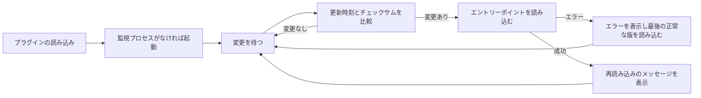

<div align="center">

# tmux-autoreload-revamped

<strong>tmuxの設定を編集して保存するだけで、キーもコマンドも使わずに自動で再読み込みされます。</strong>

[English](README.md) &nbsp;|&nbsp; 日本語 &nbsp;|&nbsp; [简体中文](README.zh-Hans.md) &nbsp;|&nbsp; [繁體中文（香港）](README.zh-HK.md)

[](https://github.com/tmux-revamped/tmux-autoreload-revamped/actions/workflows/tests.yml)
[](LICENSE)
[](CHANGELOG.md)

<p align="center">
  <a href="#what-it-does">機能</a> &nbsp;|&nbsp;
  <a href="#requirements">動作要件</a> &nbsp;|&nbsp;
  <a href="#installation">インストール</a> &nbsp;|&nbsp;
  <a href="#usage">使い方</a> &nbsp;|&nbsp;
  <a href="#configuration">設定</a> &nbsp;|&nbsp;
  <a href="#key-bindings">キーバインド</a> &nbsp;|&nbsp;
  <a href="#how-it-works">仕組み</a>
</p>

</div>

監視バックエンド**4**種類。オプション**12**個。サブコマンド**5**個。CIはLinuxとmacOSの**10**通りのツールチェーンの組み合わせでテストを実行します。

---

<a id="what-it-does"></a>

## 機能

tmuxが読み込んだすべての設定ファイルと、それらが`source`するすべてのファイルを監視します。いずれかが変更されると設定を再読み込みし、ステータスラインに`tmux config reloaded (tmux.conf)`と表示します。

- 内容のチェックサムを比較するため、バイト列が変わらない保存では再読み込みしません。
- エラーを含む編集では、失敗したファイルとtmuxのエラーメッセージを表示し、そのファイルの最後に正常に読み込めた版を読み込み直します。
- ペインがコピーモードのときの変更は保留されるため、再読み込みが選択操作を中断することはありません。すべてのペインがモードを抜けた後の最初のチェックで適用されます。ポーリングでは次の周期、監視ツールがある場合は次のファイルイベントです。
- 監視プロセスはtmuxサーバーごとに1つだけ動きます。プラグインを再読み込みすると、生きている監視プロセスはそのまま使い、停止しているものは置き換えます。

<a id="requirements"></a>

## 動作要件

| ツール | バージョン | 用途 |
|:-----|:--------|:-----------|
| tmux | 3.2以降 | 読み込まれた設定ファイルを列挙する`#{config_files}` |
| bash | 3.2以降 | macOSの`/bin/bash`を含むすべてのスクリプト |
| `fswatch`、`inotifywait`または`entr` | 任意 | 任意。イベント駆動の再読み込み。どれもなければポーリングします |
| `osascript`または`notify-send` | 任意 | 任意。デスクトップ通知 |

macOSとLinux、x86_64とarm64で動作します。ファイルの更新時刻はGNUの`stat -c`を先に、BSDの`stat -f`を次に試すため、macOS標準のツール、GNU coreutils、uutils coreutilsのいずれでも動作します。

<a id="installation"></a>

## インストール

### TPMでインストール

`~/.tmux.conf`にプラグインを追加し、`prefix + I`を押します。

```tmux
set -g @plugin 'tmux-revamped/tmux-autoreload-revamped'
```

### 手動インストール

```bash
git clone https://github.com/tmux-revamped/tmux-autoreload-revamped ~/.tmux/plugins/tmux-autoreload-revamped
```

次の行を`~/.tmux.conf`に追加し、tmuxを一度再読み込みします。

```tmux
run-shell ~/.tmux/plugins/tmux-autoreload-revamped/autoreload-revamped.tmux
```

<a id="usage"></a>

## 使い方

`~/.tmux.conf`か、そこから読み込まれるファイルを保存します。tmuxは次のファイルイベントで設定を適用します。監視ツールがない場合は`@autoreload_revamped_interval`秒以内に適用します。

[`src/autoreload.sh`](src/autoreload.sh)のスクリプトはサブコマンドも受け付けます。

| サブコマンド | 動作 |
|:-----------|:-------|
| `reload` | エントリーポイントを今すぐ読み込む |
| `pause` | 変更への反応を止める |
| `resume` | 変更への反応を再開する |
| `toggle` | 一時停止と動作中を切り替える |
| `status` | 状態、監視プロセスのpid、バックエンドを表示する |

```bash
~/.tmux/plugins/tmux-autoreload-revamped/src/autoreload.sh status
```

```text
autoreload-revamped: active; watcher pid 48213; backend fswatch
```

<a id="configuration"></a>

## 設定

| オプション | 既定値 | 意味 |
|:-------|:--------|:--------|
| `@autoreload_revamped_files` | 空 | 監視するファイル。カンマまたは空白で区切り、`~`を展開します。設定するとtmuxが読み込んだファイルの代わりに使います |
| `@autoreload_revamped_entrypoints` | 読み込まれた設定ファイル | 再読み込みのたびに読み込むファイル |
| `@autoreload_revamped_interval` | `2` | ポーリング時のチェック間隔の秒数 |
| `@autoreload_revamped_quiet` | `0` | `1`で再読み込みのメッセージを表示しない |
| `@autoreload_revamped_discover` | `1` | `source`と`source-file`の行を8階層までたどる。`0`で最上位のファイルだけを監視 |
| `@autoreload_revamped_atomic` | `1` | 各ファイルのディレクトリも監視し、名前の変更で保存するエディタにも対応する。`0`でファイルだけを監視 |
| `@autoreload_revamped_validate` | `1` | 読み込みエラー時に、失敗したファイルの最後の正常な版を読み込む。`0`でロールバックしない |
| `@autoreload_revamped_defer` | `1` | いずれかのペインがコピーモードなどのモード中は待つ。`0`ですぐに再読み込み |
| `@autoreload_revamped_selective` | `0` | `1`で、変更されたファイルをインクルードの木に含むエントリーポイントだけを読み込む |
| `@autoreload_revamped_backoff_max` | `30` | 再読み込みの失敗が続いたときのポーリング間隔の上限秒数 |
| `@autoreload_revamped_flash` | `0` | `1`で再読み込みのメッセージを反転表示でもう一度表示 |
| `@autoreload_revamped_notify` | `0` | `1`で再読み込みのたびにデスクトップ通知を送る |

```tmux
set -g @autoreload_revamped_files '~/.tmux.conf ~/.config/tmux/theme.conf'
set -g @autoreload_revamped_notify '1'
```

### 内部状態

次のオプションはプラグインが自身で書き込みます。設定しないでください。

| オプション | 内容 |
|:-------|:------|
| `@autoreload_revamped_pid` | 動作中の監視プロセスのpid |
| `@autoreload_revamped_paused` | 一時停止中は`1`、それ以外は`0` |
| `@autoreload_revamped_snapshot` | 監視対象ファイルごとの`path mtime`の行 |
| `@autoreload_revamped_hash` | 監視対象のすべてのファイル内容のチェックサム |
| `@autoreload_revamped_fail_count` | 連続した再読み込みの失敗回数。ポーリング間隔を`@autoreload_revamped_backoff_max`まで延ばします |

<a id="key-bindings"></a>

## キーバインド

このプラグインはキーを割り当てません。tmuxから再読み込みや一時停止をするには、サブコマンドを自分で割り当てます。

```tmux
bind R run-shell "~/.tmux/plugins/tmux-autoreload-revamped/src/autoreload.sh reload"
bind P run-shell "~/.tmux/plugins/tmux-autoreload-revamped/src/autoreload.sh toggle"
```

<a id="how-it-works"></a>

## 仕組み



監視プロセスは`fswatch`、`inotifywait`、`entr`の順に最初に見つかったツールを使い、どれもなければポーリングします。ポーリングは再読み込みが失敗するたびに待ち時間を倍にし、上限は`@autoreload_revamped_backoff_max`秒です。

監視プロセスは起動時にtmuxサーバーのpidを記録します。そのサーバーがなくなるか、ソケットで別のサーバーが応答すると終了します。

エントリーポイントのバックアップは`~/.tmux/autoreload-revamped/backup`に置かれます。監視プロセスは起動時と、再読み込みが成功するたびに書き込みます。場所を変えるには環境変数`AR_CACHE_DIR`を設定します。

<a id="development"></a>

## 開発

| コマンド | 実行内容 |
|:--------|:-------------|
| `make test` | [`test/`](test)以下のbatsテスト |
| `make lint` | すべてのシェルファイルへのshellcheck |
| `make coverage` | Linuxでのkcovによる行カバレッジ。95%未満で失敗します |

監視ツールの選択、変更の検出、パスの処理を行う純粋関数は[`src/lib/autoreload/autoreload.sh`](src/lib/autoreload/autoreload.sh)にあります。

<a id="license"></a>

## ライセンス

[MIT](LICENSE)、copyright Gustavo Franco。

<!-- family:begin -->

## tmux-revampedファミリー

このプラグインはtmux-revampedファミリーの一員です。すべてのメンバーが[`FAMILY.md`](FAMILY.md)の同じ規約、`family/`以下の同じツール、同じ共有ライブラリを持ち、チェックサムの一覧でバイト単位まで同一に保たれています。一緒にインストールする前提で作られており、どのメンバーも他のメンバーが使うキーやtmuxオプションを使いません。

あるメンバーで見つかった不具合は、修正の完了を宣言する前にすべてのメンバーで探します。この義務は記憶に頼らず規約に書かれており、`family/bin/sweep`で果たします。

| メンバー | 内容 |
|---|---|
| [`tmux-autoreload-revamped`](https://github.com/tmux-revamped/tmux-autoreload-revamped) | **このプラグイン**、tmuxの設定を編集して保存するだけで、キーもコマンドも使わずに自動で再読み込みされる |
| [`tmux-battery-revamped`](https://github.com/tmux-revamped/tmux-battery-revamped) | tmuxのステータスバーに電池の状態を表示し、描画を一切止めない |
| [`tmux-bluetooth-revamped`](https://github.com/tmux-revamped/tmux-bluetooth-revamped) | 接続中のすべてのBluetooth機器とその電池残量をtmuxのステータスバーに表示し、描画を止めない |
| [`tmux-cpu-revamped`](https://github.com/tmux-revamped/tmux-cpu-revamped) | CPUの負荷、温度、周波数をtmuxのステータスバーに表示し、描画を一切止めない |
| [`tmux-disk-revamped`](https://github.com/tmux-revamped/tmux-disk-revamped) | tmuxのステータスバーにディスク使用量を表示し、描画を一切止めない |
| [`tmux-extract-revamped`](https://github.com/tmux-revamped/tmux-extract-revamped) | 画面上のURL、パス、ハッシュなどの文字列をfzfで選び、カーソル位置に入力する。純粋なシェルで実装 |
| [`tmux-fzf-revamped`](https://github.com/tmux-revamped/tmux-fzf-revamped) | ポップアップのfzf選択画面からtmuxのセッション、ウィンドウ、ペインを切り替え、終了、改名、作成する |
| [`tmux-git-revamped`](https://github.com/tmux-revamped/tmux-git-revamped) | アクティブなペインのgitブランチ、変更、プロバイダーの件数をtmuxのステータスバーに表示し、描画を止めない |
| [`tmux-gpu-revamped`](https://github.com/tmux-revamped/tmux-gpu-revamped) | NVIDIA、AMD、Intel、AppleのGPUの負荷、温度、クロック、電力、メモリをtmuxのステータスバーに表示する |
| [`tmux-kube-revamped`](https://github.com/tmux-revamped/tmux-kube-revamped) | 現在のKubernetesコンテキストと名前空間をkubectlなしでkubeconfigから読み取り、tmuxのステータスバーに表示する |
| [`tmux-launcher-revamped`](https://github.com/tmux-revamped/tmux-launcher-revamped) | 任意のTUIアプリを現在のペインのディレクトリでポップアップかウィンドウに起動する。キーは設定可能 |
| [`tmux-logging-revamped`](https://github.com/tmux-revamped/tmux-logging-revamped) | 任意のペインをファイルに保存する。ライブのログ記録、スクロールバック全体、1回限りのスクリーンショット |
| [`tmux-music-revamped`](https://github.com/tmux-revamped/tmux-music-revamped) | 再生中の曲をtmuxのステータスバーに表示し、描画を一切止めない |
| [`tmux-network-revamped`](https://github.com/tmux-revamped/tmux-network-revamped) | ネットワークのスループットをtmuxのステータスバーに表示し、描画を一切止めない |
| [`tmux-pain-control-revamped`](https://github.com/tmux-revamped/tmux-pain-control-revamped) | tmuxの標準的なペインとウィンドウの操作キー。バージョンに対応し、vim風で、すべて設定可能 |
| [`tmux-persist-revamped`](https://github.com/tmux-revamped/tmux-persist-revamped) | tmuxのすべてのセッション、ウィンドウ、ペインを保存し、定期的に自動保存し、再起動後にすべて復元する |
| [`tmux-plugin-template`](https://github.com/tmux-revamped/tmux-plugin-template) | tmux-revampedプラグインの出発点。共有ライブラリ、batsのテスト環境、CI、ファミリーのツール |
| [`tmux-pomodoro-revamped`](https://github.com/tmux-revamped/tmux-pomodoro-revamped) | tmuxのステータスバーに表示するポモドーロタイマー。状態はすべてtmuxのオプションに持ち、一時ファイルを使わない |
| [`tmux-ram-revamped`](https://github.com/tmux-revamped/tmux-ram-revamped) | RAM、スワップ、メモリ圧迫をtmuxのステータスバーに表示する。計測はバックグラウンドで行い、描画を待たせない |
| [`tmux-reorder-revamped`](https://github.com/tmux-revamped/tmux-reorder-revamped) | tmuxのステータスバー上のウィンドウのタブをマウスでドラッグして、そのウィンドウを移動する |
| [`tmux-scroll-revamped`](https://github.com/tmux-revamped/tmux-scroll-revamped) | マウスホイールを、自分でスクロールするアプリにはそのまま送り、それ以外ではtmuxのコピーモードに入れる |
| [`tmux-sensible-revamped`](https://github.com/tmux-revamped/tmux-sensible-revamped) | tmuxのバージョンと端末に応じて適用する実用的な既定値。自分で設定したオプションには触れない |
| [`tmux-tiling-revamped`](https://github.com/tmux-revamped/tmux-tiling-revamped) | tmuxのタイル型ウィンドウ管理。BSPのdwindleとspiralを含む8種類のレイアウトと、レイアウトの取り消し |
| [`tmux-time-revamped`](https://github.com/tmux-revamped/tmux-time-revamped) | tmuxのステータスバーに現地時計と世界時計を表示する。時間帯で色分けし、カウントダウンと夏時間の警告付き |
| [`tmux-weather-revamped`](https://github.com/tmux-revamped/tmux-weather-revamped) | wttr.inの天気をtmuxのステータスバーに表示する。取得はバックグラウンドで行い、ステータスラインを待たせない |

### インストールの確認

すべてのメンバーがディスク上にあれば、1つのコマンドでメンバー間の衝突を報告します。

```sh
family/bin/doctor --live
```

各メンバーと動作中のtmuxサーバーを読み、重複したキー、重複したステータスのプレースホルダー、命名規則に外れたオプション、規約のバージョンが遅れているメンバーを報告します。

<!-- family:end -->
