<div align="center">

# tmux-autoreload-revamped

<strong>tmuxの設定を編集して保存するだけで、キーもコマンドも使わずに自動で再読み込みされます。</strong>

[English](README.md) &nbsp;|&nbsp; 日本語 &nbsp;|&nbsp; [简体中文](README.zh-Hans.md) &nbsp;|&nbsp; [繁體中文（香港）](README.zh-HK.md)

[](https://github.com/tmux-revamped/tmux-autoreload-revamped/actions/workflows/ci.yml)
[](https://github.com/tmux-revamped/tmux-autoreload-revamped/releases/latest)
[](https://scorecard.dev/viewer/?uri=github.com/tmux-revamped/tmux-autoreload-revamped)
[](LICENSE)

<p align="center">
  <a href="#クイックスタート"><strong>クイックスタート</strong></a> &nbsp;|&nbsp;
  <a href="#使い方">使い方</a> &nbsp;|&nbsp;
  <a href="#しくみ">しくみ</a> &nbsp;|&nbsp;
  <a href="#画面">画面</a>
</p>

</div>

<p align="center">
  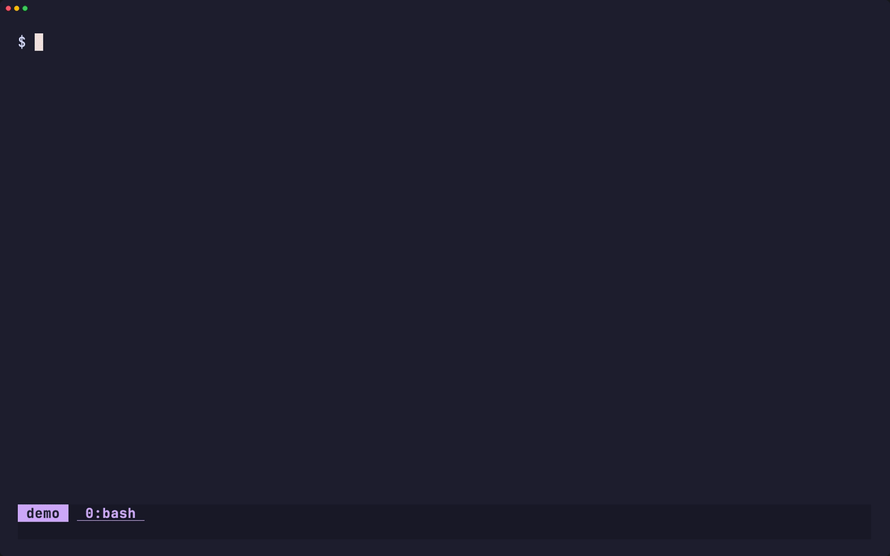
</p>

```console
$ echo 'set -g status-style bg=blue' >> ~/.tmux.conf
$ autoreload-revamped status
autoreload-revamped: active; watcher pid 48213; backend fswatch
```

プラグインは、tmux が読み込んだ設定ファイルと、それらが `source` するファイルをすべて監視します。内容が変わって保存されると、設定をもう一度読み込み、ステータスラインに `tmux config reloaded (tmux.conf)` と表示します。バイトが変わらない保存では何も再読み込みしません。壊れた保存では tmux のエラーを 1 回だけ表示し、最後に正常だったコピーを読み込み直します。ペインがコピーモードにある間の変更は、ペインがモードを抜けるまで待ちます。

---

## クイックスタート

### 前提条件

| ツール | バージョン | 用途 |
|:-----|:--------|:---------|
| tmux | 3.2 以降 | ファミリー共通の最低バージョン。読み込んだ設定ファイルを列挙する `#{config_files}` にも必要です |
| `fswatch`、`inotifywait`、`entr` のいずれか | 任意 | 保存と同時に再読み込みします。なければ `@autoreload_revamped_interval` 秒ごとに確認します |
| `osascript` または `notify-send` | 任意 | `@autoreload_revamped_notify` 用 |
| gum | 任意 | `autoreload-revamped` のメニュー、表、色。なくてもすべてのコマンドがプレーンテキストで動きます |

### インストール

```tmux
set -g @plugin 'tmux-revamped/tmux-autoreload-revamped'
```

続けて `prefix + I` を押します。TPM を使わない場合は、リポジトリをクローンし、`~/.tmux.conf` からエントリーポイントを実行します。

```bash
git clone https://github.com/tmux-revamped/tmux-autoreload-revamped ~/.tmux/plugins/tmux-autoreload-revamped
```

```tmux
run-shell ~/.tmux/plugins/tmux-autoreload-revamped/autoreload-revamped.tmux
```

クローンで `make install` を実行すると、`autoreload-revamped` が `~/.local/bin` に、manページと補完が `~/.local/share` の下に入ります。

### 確認

```bash
~/.tmux/plugins/tmux-autoreload-revamped/bin/autoreload-revamped doctor
```

## 使い方

`~/.tmux.conf`、またはそれが source するファイルを保存します。プラグインはキーを割り当てません。キーが欲しいときは、コマンドを自分で割り当てます。

```tmux
bind-key <key> run-shell "~/.tmux/plugins/tmux-autoreload-revamped/bin/autoreload-revamped toggle"
```

| コマンド | 動作 |
|:--------|:-------------|
| `autoreload-revamped apply` | ウォッチャーが動いていなければ起動します。プラグインの読み込み時にエントリーポイントが実行します |
| `autoreload-revamped watch` | tmux サーバーが終わるまで設定ファイルを監視します。`apply` が残すプロセスです |
| `autoreload-revamped reload` | エントリーポイントを今すぐ読み込みます |
| `autoreload-revamped pause` | 変更への反応を止めます |
| `autoreload-revamped resume` | 変更への反応を再開します。停止中の保存は 1 間隔以内に読み込みます |
| `autoreload-revamped toggle` | 停止と再開を切り替えます |
| `autoreload-revamped status` | 状態、ウォッチャーの pid、バックエンドを表示します。`--json` で 1 つのオブジェクトを出力します |
| `autoreload-revamped doctor` | 依存関係ごとに 1 行。監視ツールも含みます |
| `autoreload-revamped version` | バージョンと tmux のバージョン |
| `autoreload-revamped help` | ヘルプ。`man autoreload-revamped` にも同じコマンドと設定があります |
| `autoreload-revamped` | 端末ではメニュー |

| tmux オプション | 既定値 | 意味 |
|:------------|:--------|:--------|
| `@autoreload_revamped_files` | なし | 監視するファイル。カンマか空白で区切り、`~` を展開します。設定すると tmux が読み込んだファイルの代わりになります |
| `@autoreload_revamped_entrypoints` | 読み込んだ設定ファイル | 再読み込みで source するファイル |
| `@autoreload_revamped_interval` | `2` | 監視ツールがないときの確認間隔の秒数。保留中や停止中の再読み込みを確かめ直す間隔でもあります |
| `@autoreload_revamped_quiet` | `0` | `1` で再読み込みのメッセージを隠します |
| `@autoreload_revamped_discover` | `1` | `source` と `source-file` の行を 8 階層までたどります。`0` は最上位のファイルだけを監視します |
| `@autoreload_revamped_atomic` | `1` | 各ファイルのフォルダーも監視し、名前の変更で保存するエディターを捉えます。`0` はファイルだけを監視します |
| `@autoreload_revamped_validate` | `1` | 読み込みに失敗したとき、そのファイルの最後に正常だったコピーを読み込みます。`0` はそれを行いません |
| `@autoreload_revamped_defer` | `1` | いずれかのペインがコピーモードなどのモードにある間は待ちます。`0` はすぐに再読み込みします |
| `@autoreload_revamped_selective` | `0` | `1` は、変更されたファイルを含むエントリーポイントだけを読み込みます |
| `@autoreload_revamped_flash` | `0` | `1` は再読み込みのメッセージを反転表示でもう一度出します |
| `@autoreload_revamped_notify` | `0` | `1` は再読み込みのたびにデスクトップ通知を送ります |
| `@autoreload_revamped_backup_dir` | `~/.tmux/autoreload-revamped/backup` | 各エントリーポイントの最後に正常だったコピーを置くフォルダー |

どのオプションも、ダッシュ区切りのコマンドオプション（例 `--interval 5`）と環境変数（例 `AUTORELOAD_REVAMPED_INTERVAL`）で指定できます。優先順位はコマンドライン、環境変数、tmux オプションの順です。空の tmux オプションは既定値を意味します。`doctor` は、プラグインが認識できない値を持つ設定の名前を表示します。`@autoreload_revamped_pid` と `@autoreload_revamped_paused` はプラグイン自身が書き込みます。

<a id="しくみ"></a>

## しくみ

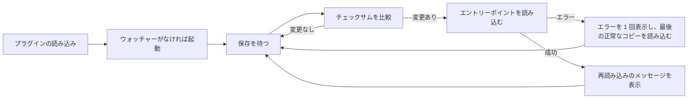

ウォッチャーは、`fswatch`、`inotifywait`、`entr` の順で最初に見つかったツールを使い、どれもなければ `@autoreload_revamped_interval` 秒ごとに確認します。チェックサムは、監視するすべてのファイルに対する 1 回の `cksum` です。

ウォッチャーは起動時に tmux サーバーの pid を記録し、そのサーバーが終了するか、別のサーバーがソケットで応答すると終了します。ウォッチャーは tmux サーバーごとに 1 つです。プラグインを読み込み直すと、生きているウォッチャーはそのまま使い、止まっていれば起動し直します。

各エントリーポイントの最後に正常だったコピーは `~/.tmux/autoreload-revamped/backup` に置き、ウォッチャーの起動時と、再読み込みが成功するたびに書き込みます。`@autoreload_revamped_backup_dir` で場所を変えられます。

<a id="画面"></a>

## 画面

<details>
<summary>すべての画面。本物の tmux の中で <code>make screens</code> で録画し、押したキーをステータスラインに表示しています</summary>
<br>

<table>
<tr>
<td width="50%" valign="top">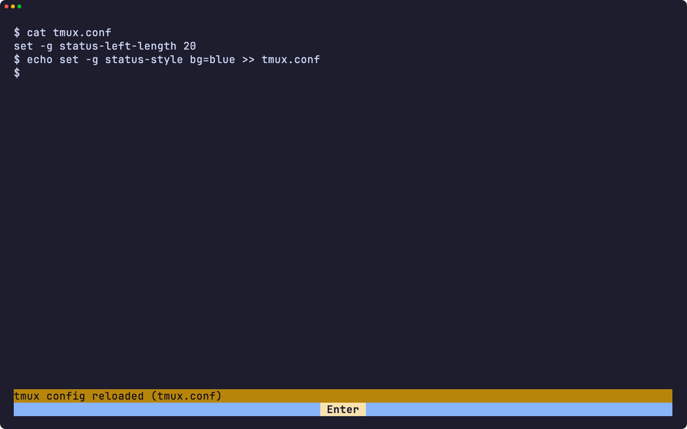<br><sub>保存すると設定を再読み込みし、ステータスラインに知らせる。<code>hero.tape</code>より</sub></td>
<td width="50%" valign="top">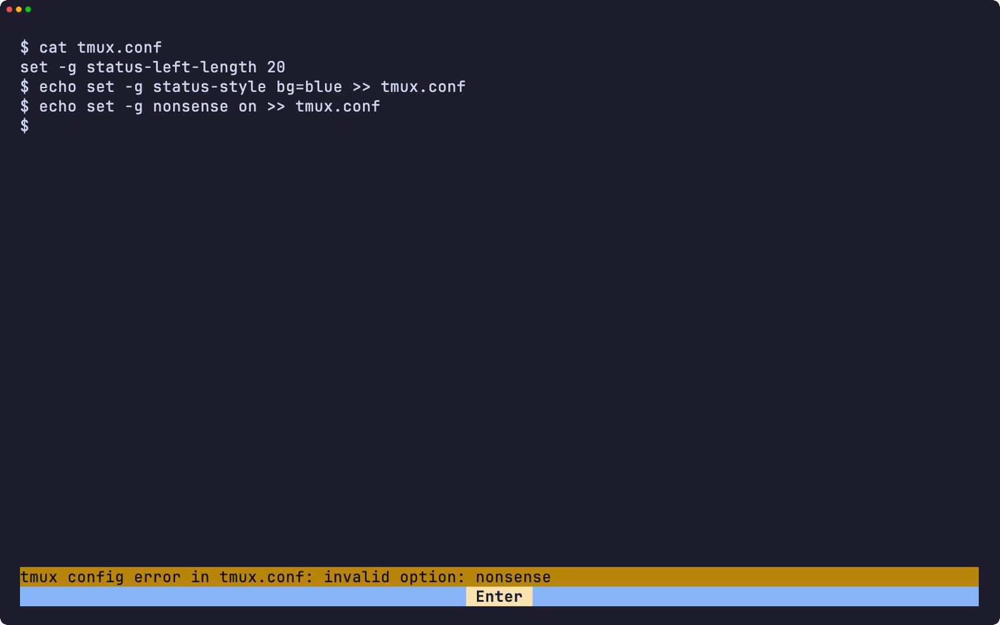<br><sub>壊れた保存は tmux のエラーを表示し、最後の正常なコピーを保つ。<code>hero.tape</code>より</sub></td>
</tr>
<tr>
<td width="50%" valign="top">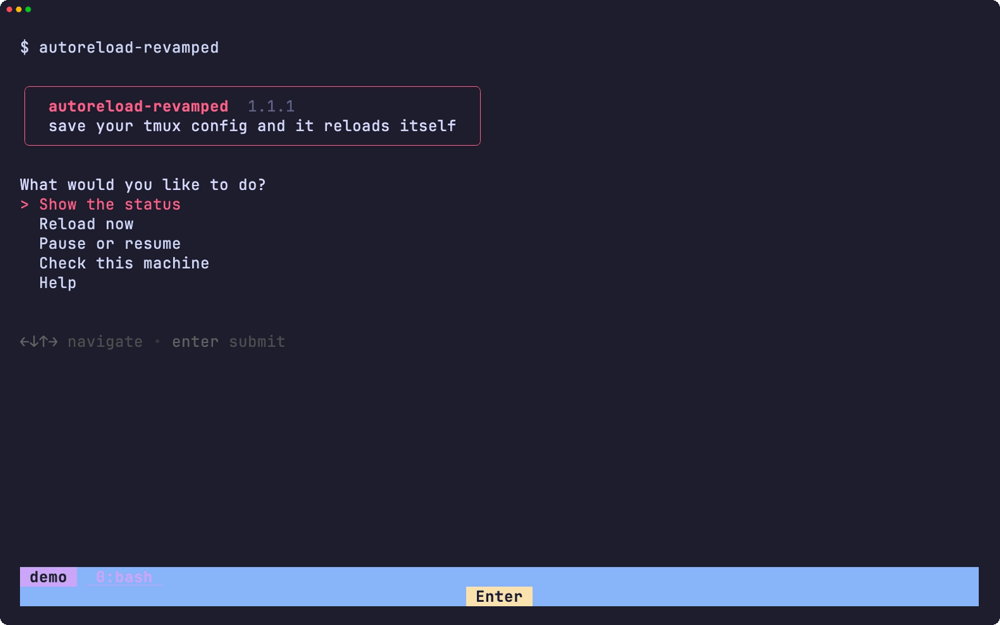<br><sub>メニュー。<code>hero.tape</code>より</sub></td>
<td width="50%" valign="top">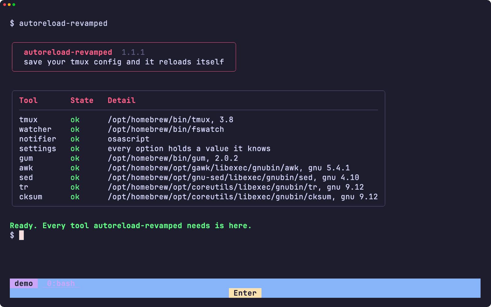<br><sub><code>doctor</code>。<code>hero.tape</code>より</sub></td>
</tr>
<tr>
<td width="50%" valign="top">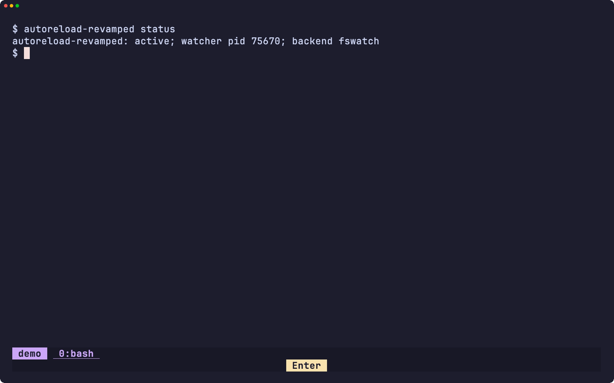<br><sub><code>status</code>。<code>stills.tape</code>より</sub></td>
<td width="50%" valign="top">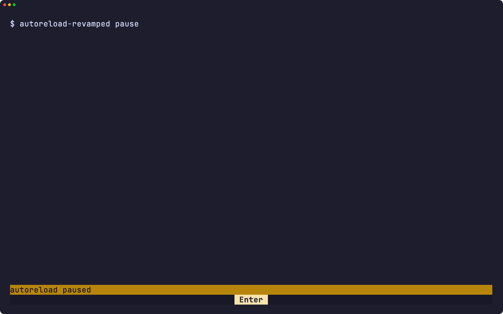<br><sub><code>pause</code> は変更への反応を止める。<code>stills.tape</code>より</sub></td>
</tr>
<tr>
<td width="50%" valign="top">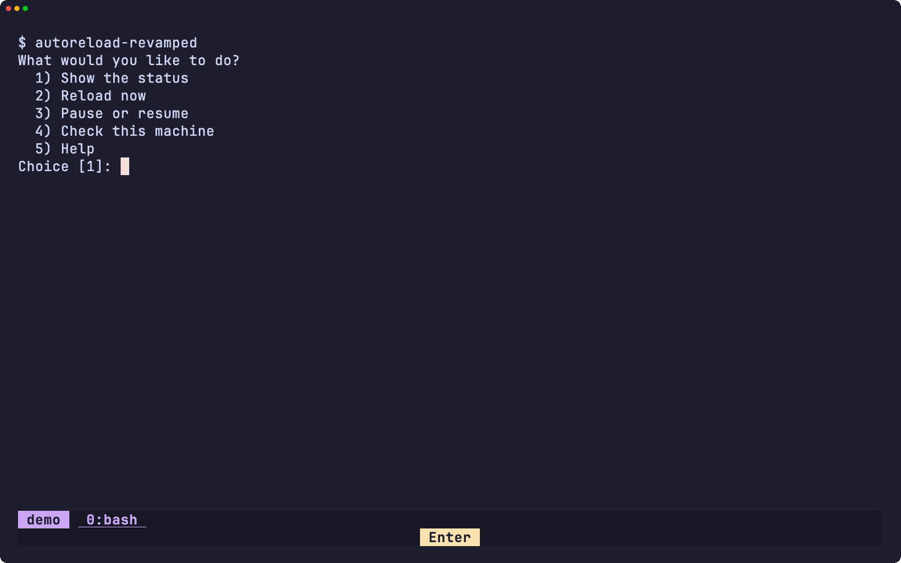<br><sub>gum なしのメニュー。<code>stills.tape</code>より</sub></td>
<td width="50%" valign="top">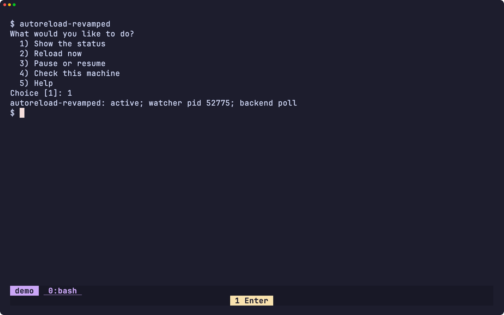<br><sub>メニューからの <code>status</code>。<code>stills.tape</code>より</sub></td>
</tr>
<tr>
<td width="50%" valign="top">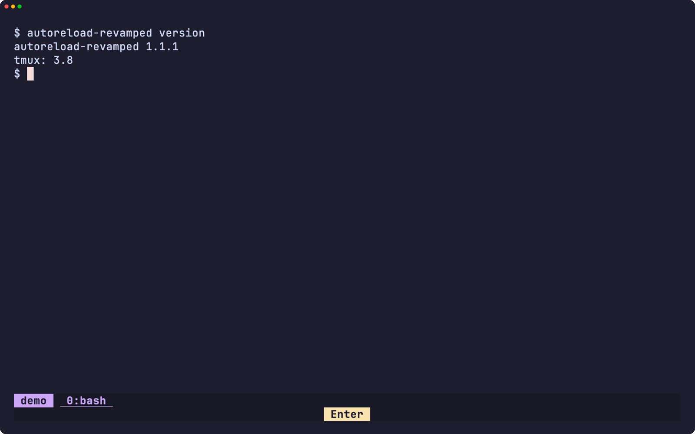<br><sub>バージョン。<code>stills.tape</code>より</sub></td>
<td width="50%" valign="top">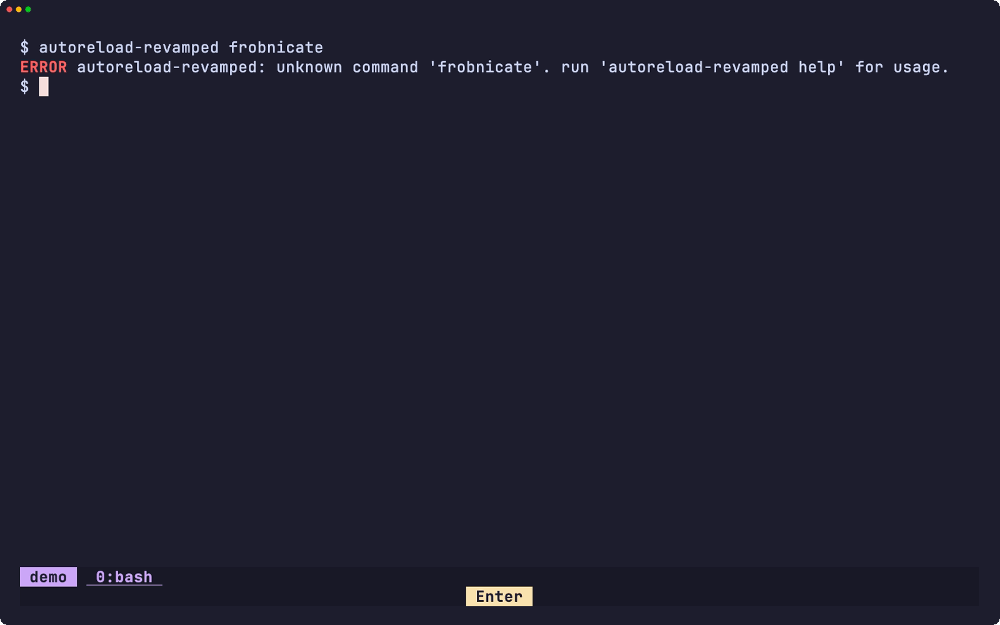<br><sub>不明なコマンド。<code>stills.tape</code>より</sub></td>
</tr>
<tr>
<td width="50%" valign="top">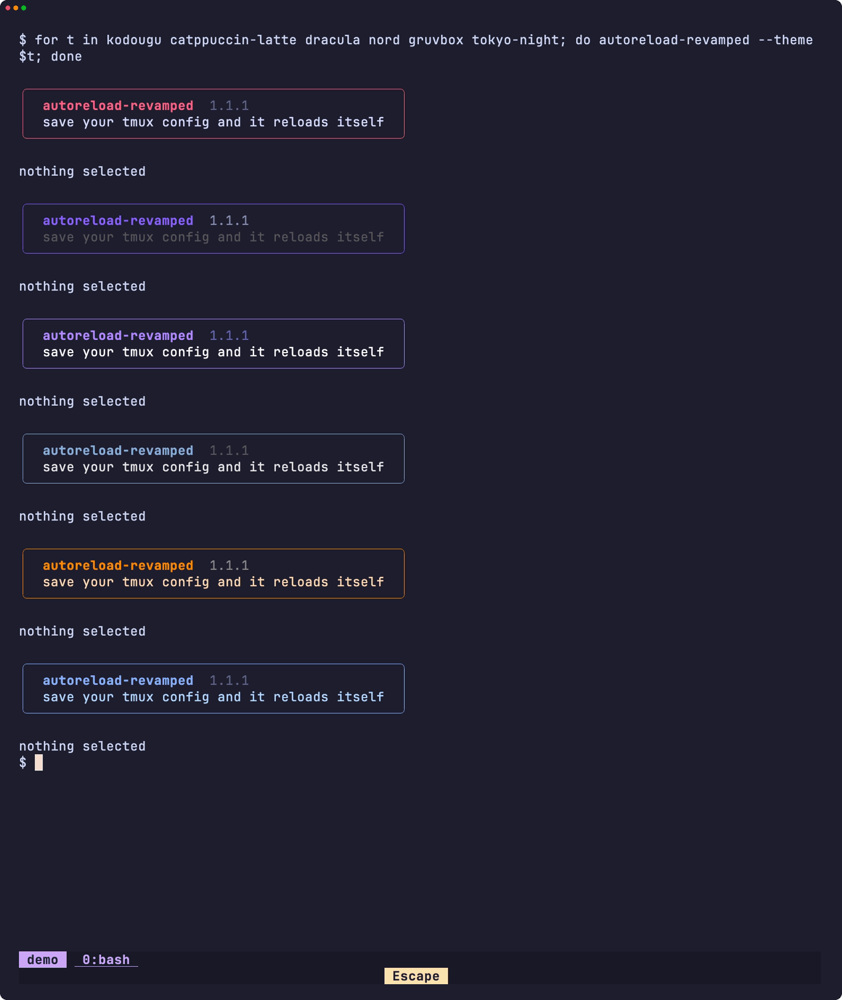<br><sub>6 つのテーマのヘッダー。<code>themes.tape</code>より</sub></td>
<td width="50%" valign="top">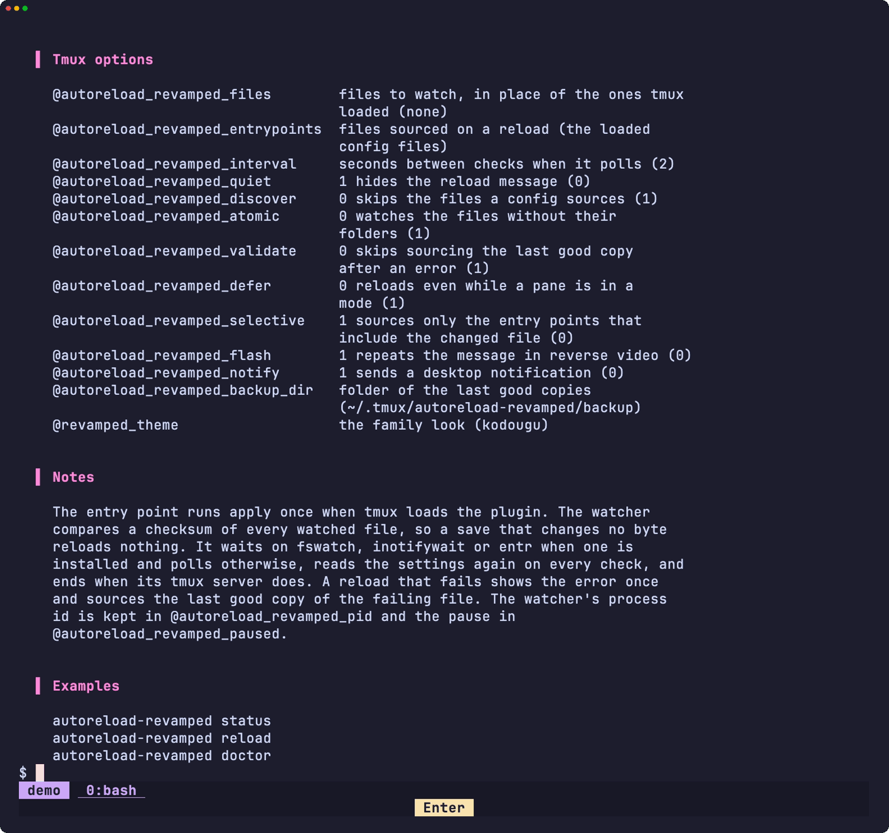<br><sub>ヘルプ。<code>help.tape</code>より</sub></td>
</tr>
<tr>
<td width="50%" valign="top">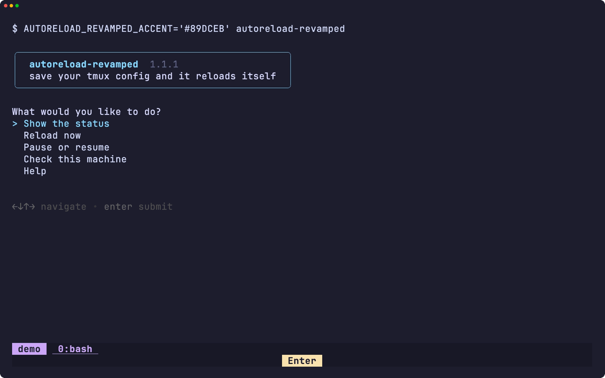<br><sub><code>AUTORELOAD_REVAMPED_ACCENT</code> によるアクセント。<code>stills.tape</code>より</sub></td>
<td width="50%" valign="top"></td>
</tr>
</table>

</details>

## 移植性

プラグインは POSIX `sh` です。CI は下の各行ですべてのテストを実行します。

| シェル | 状態 |
|:------|:-------|
| `dash`、macOS の `/bin/sh` | 対応 |
| `bash` 3.2 と 5.x、システムの `zsh` と Homebrew の `zsh` | 対応 |

| システム | 状態 |
|:-------|:-------|
| macOS | Apple Silicon と Intel の Tahoe。付属のツール、Homebrew の GNU ツール、Homebrew の uutils で確認 |
| Linux | x86_64 と arm64 の Ubuntu 26.04。GNU coreutils、uutils、BusyBox で確認 |

## 開発

| コマンド | 実行内容 |
|:--------|:-------------|
| `make fmt` | すべてのスクリプトに shfmt `-i 2` をかけます |
| `make lint` | shfmt、ShellCheck、mandoc、yamllint、actionlint を、指摘ゼロで通します |
| `make test` | システムの `sh` で bats のテスト |
| `make test-all` | インストール済みのすべてのシェルでテスト。macOS では bash と zsh の両方のビルドを含みます |
| `make test-linux` | Ubuntu のコンテナでテスト |
| `make coverage` | この Mac と Ubuntu のコンテナで bashcov を実行し、合算して 100 パーセントで判定します |
| `make screens` | 上の画面を、本物のプラグインから tmux の中で VHS で録画します。macOS で実行します |
| `make install` | コマンド、manページ、補完を `PREFIX` の下に置きます |

macOS では、`brew bundle` を実行すると、これらのターゲットが使うツールがすべて [`Brewfile`](Brewfile) からインストールされます。

コミットは Conventional Commits の形式に従い、そのまま `main` に入ります。`main` で `ci` が成功すると、`release.yml` が semantic-release を実行します。前回のタグ以降に `feat` か `fix` があればリリースを公開し、バージョン定数を更新し、変更内容を [`CHANGELOG.md`](CHANGELOG.md) に追加します。

## ライセンス

[MIT](LICENSE)、copyright Gustavo Franco。

<!-- family:begin -->

## tmux-revamped ファミリー

このプラグインは tmux-revamped ファミリーの一員です。すべてのメンバーが [`FAMILY.md`](FAMILY.md) の同じ規約と同じ共有ライブラリを持ちます。メンバーは一緒にインストールする前提で作られており、ほかのメンバーが使うキーや tmux オプションを使うメンバーはありません。

あるメンバーで見つかった不具合は、修正完了とする前に全メンバーで同じ不具合を探します。

| メンバー | 機能 |
|---|---|
| [`tmux-autoreload-revamped`](https://github.com/tmux-revamped/tmux-autoreload-revamped) | **このプラグイン**、tmuxの設定を編集して保存するだけで、キーもコマンドも使わずに自動で再読み込みされます |
| [`tmux-battery-revamped`](https://github.com/tmux-revamped/tmux-battery-revamped) | tmuxのステータスバーに電池の状態を表示し、ステータスの描画を一切止めません |
| [`tmux-bluetooth-revamped`](https://github.com/tmux-revamped/tmux-bluetooth-revamped) | 接続中のすべてのBluetooth機器とその電池残量をtmuxのステータスバーに表示し、描画を止めません |
| [`tmux-cpu-revamped`](https://github.com/tmux-revamped/tmux-cpu-revamped) | CPUの負荷、温度、周波数をtmuxのステータスバーに表示し、描画を一切止めません |
| [`tmux-disk-revamped`](https://github.com/tmux-revamped/tmux-disk-revamped) | tmuxのステータスバーにディスク使用量を表示し、ステータスの描画を一切止めません |
| [`tmux-extract-revamped`](https://github.com/tmux-revamped/tmux-extract-revamped) | 画面上の URL、パス、ハッシュなどのトークンを fzf で選び、カーソル位置に入力します。純粋なシェルだけで動きます |
| [`tmux-fzf-revamped`](https://github.com/tmux-revamped/tmux-fzf-revamped) | ポップアップ内の fzf ピッカーから、tmux のセッション、ウィンドウ、ペインの切り替え、終了、名前変更、作成を行います |
| [`tmux-git-revamped`](https://github.com/tmux-revamped/tmux-git-revamped) | アクティブなペインのgitブランチ、変更、プロバイダーの件数を、描画を止めずにtmuxのステータスバーに表示します |
| [`tmux-gpu-revamped`](https://github.com/tmux-revamped/tmux-gpu-revamped) | NVIDIA、AMD、Intel、Apple の GPU の負荷、温度、クロック、電力、メモリを tmux のステータスバーに表示します |
| [`tmux-kube-revamped`](https://github.com/tmux-revamped/tmux-kube-revamped) | 現在の Kubernetes コンテキストと名前空間を、kubectl を使わずに kubeconfig から解析して tmux のステータスバーに表示します |
| [`tmux-launcher-revamped`](https://github.com/tmux-revamped/tmux-launcher-revamped) | 任意の TUI アプリを、現在のペインのディレクトリでポップアップまたはウィンドウとして起動します。アプリごとにキーを設定できます |
| [`tmux-logging-revamped`](https://github.com/tmux-revamped/tmux-logging-revamped) | 任意のペインをファイルに保存します。ライブのログ記録、スクロールバック全体、1 回限りのスクリーンショットに対応します |
| [`tmux-music-revamped`](https://github.com/tmux-revamped/tmux-music-revamped) | 再生中の曲をステータスバーに表示し、ステータスの描画を止めません |
| [`tmux-network-revamped`](https://github.com/tmux-revamped/tmux-network-revamped) | ネットワークのスループットをステータスバーに表示し、描画を止めません |
| [`tmux-pain-control-revamped`](https://github.com/tmux-revamped/tmux-pain-control-revamped) | tmux のペインとウィンドウの操作キー。tmux のバージョンに対応し、vim と共存でき、どの prefix キーも無効にできます |
| [`tmux-persist-revamped`](https://github.com/tmux-revamped/tmux-persist-revamped) | tmuxのすべてのセッション、ウィンドウ、ペインを保存し、タイマーで自動保存して、再起動後にすべて復元します |
| [`tmux-plugin-template`](https://github.com/tmux-revamped/tmux-plugin-template) | tmux-revampedプラグインの出発点です。共有ライブラリ、batsハーネス、CIを含みます |
| [`tmux-pomodoro-revamped`](https://github.com/tmux-revamped/tmux-pomodoro-revamped) | すべての状態をtmuxオプションに保持し、一時ファイルを使わない、tmuxステータスバーのポモドーロタイマーです |
| [`tmux-ram-revamped`](https://github.com/tmux-revamped/tmux-ram-revamped) | RAM、スワップ、メモリプレッシャーをtmuxのステータスバーに表示します。計測はバックグラウンドで行うため描画を待たせません |
| [`tmux-reorder-revamped`](https://github.com/tmux-revamped/tmux-reorder-revamped) | tmuxのステータスバー上でウィンドウのタブをマウスでドラッグして、そのウィンドウを移動します |
| [`tmux-scroll-revamped`](https://github.com/tmux-revamped/tmux-scroll-revamped) | 自分でスクロールできるアプリにはマウスホイールを渡し、それ以外ではtmuxのコピーモードに入ります |
| [`tmux-sensible-revamped`](https://github.com/tmux-revamped/tmux-sensible-revamped) | tmuxのバージョンと端末に合わせて適用され、ユーザーが設定したオプションには触れない、妥当な初期設定です |
| [`tmux-tiling-revamped`](https://github.com/tmux-revamped/tmux-tiling-revamped) | tmuxのタイル型ウィンドウ管理です。BSPのdwindleとspiralを含む8つのレイアウトと、レイアウトの取り消しがあります |
| [`tmux-time-revamped`](https://github.com/tmux-revamped/tmux-time-revamped) | ステータスバーにローカル時計と世界時計を時間帯ごとの色で表示し、カウントダウンと夏時間の警告も出します |
| [`tmux-weather-revamped`](https://github.com/tmux-revamped/tmux-weather-revamped) | wttr.inの天気をバックグラウンドで取得し、ステータスバーを待たせずに表示します |

<!-- family:end -->
