<div align="center">

# tmux-autoreload-revamped

<strong>Edit your tmux config, save, and watch it reload itself, no key, no command.</strong>

English &nbsp;|&nbsp; [日本語](README.ja.md) &nbsp;|&nbsp; [简体中文](README.zh-Hans.md) &nbsp;|&nbsp; [繁體中文（香港）](README.zh-HK.md)

[](https://github.com/tmux-revamped/tmux-autoreload-revamped/actions/workflows/ci.yml)
[](https://github.com/tmux-revamped/tmux-autoreload-revamped/releases/latest)
[](https://scorecard.dev/viewer/?uri=github.com/tmux-revamped/tmux-autoreload-revamped)
[](LICENSE)

<p align="center">
  <a href="#quick-start"><strong>Quick start</strong></a> &nbsp;|&nbsp;
  <a href="#usage">Usage</a> &nbsp;|&nbsp;
  <a href="#how-it-works">How it works</a> &nbsp;|&nbsp;
  <a href="#screens">Screens</a>
</p>

</div>

<p align="center">
  
</p>

```console
$ echo 'set -g status-style bg=blue' >> ~/.tmux.conf
$ autoreload-revamped status
autoreload-revamped: active; watcher pid 48213; backend fswatch
```

The plugin watches every config file tmux loaded, plus every file those files `source`. When one is saved with different content, it sources your config again and shows `tmux config reloaded (tmux.conf)` in the status line. A save that changes no byte reloads nothing, a broken save shows tmux's error once and puts the last good copy back, and a change made while a pane is in copy-mode waits until the pane leaves it.

---

## Quick start

### Prerequisites

| Tool | Version | Used for |
|:-----|:--------|:---------|
| tmux | 3.2 or later | the family floor, and `#{config_files}`, which lists the loaded config files |
| `fswatch`, `inotifywait` or `entr` | optional | a reload on the save itself; without one the plugin checks every `@autoreload_revamped_interval` seconds |
| `osascript` or `notify-send` | optional | `@autoreload_revamped_notify` |
| gum | optional | the menu, tables and colours of `autoreload-revamped`; without it every command prints plain text |

### Install

```tmux
set -g @plugin 'tmux-revamped/tmux-autoreload-revamped'
```

Then press `prefix + I`. Without TPM, clone the repository and run its entry point from `~/.tmux.conf`:

```bash
git clone https://github.com/tmux-revamped/tmux-autoreload-revamped ~/.tmux/plugins/tmux-autoreload-revamped
```

```tmux
run-shell ~/.tmux/plugins/tmux-autoreload-revamped/autoreload-revamped.tmux
```

`make install` in the clone also puts `autoreload-revamped` in `~/.local/bin`, with its man page and completions under `~/.local/share`.

### Verify

```bash
~/.tmux/plugins/tmux-autoreload-revamped/bin/autoreload-revamped doctor
```

## Usage

Save `~/.tmux.conf`, or any file it sources. The plugin binds no key; bind a command yourself when you want one:

```tmux
bind-key <key> run-shell "~/.tmux/plugins/tmux-autoreload-revamped/bin/autoreload-revamped toggle"
```

| Command | What it does |
|:--------|:-------------|
| `autoreload-revamped apply` | Starts the watcher, unless one is alive; the entry point runs it when tmux loads the plugin |
| `autoreload-revamped watch` | Watches the config files until the tmux server ends; this is what `apply` leaves running |
| `autoreload-revamped reload` | Sources the entry points now |
| `autoreload-revamped pause` | Stops reacting to changes |
| `autoreload-revamped resume` | Reacts to changes again; a save made during the pause is loaded within one interval |
| `autoreload-revamped toggle` | Switches between paused and active |
| `autoreload-revamped status` | Prints the state, the watcher's pid and its backend; `--json` prints one object |
| `autoreload-revamped doctor` | One row per dependency, the watcher tool included |
| `autoreload-revamped version` | The version, then the tmux version |
| `autoreload-revamped help` | The help page; `man autoreload-revamped` documents the same commands and settings |
| `autoreload-revamped` | On a terminal, a menu |

| tmux option | Default | Meaning |
|:------------|:--------|:--------|
| `@autoreload_revamped_files` | none | Files to watch, separated by commas or spaces, with `~` expanded; when set, it replaces the files tmux loaded |
| `@autoreload_revamped_entrypoints` | the loaded config files | Files sourced on a reload |
| `@autoreload_revamped_interval` | `2` | Seconds between checks when no watcher tool is installed, and between retries of a reload that is held back or paused |
| `@autoreload_revamped_quiet` | `0` | `1` hides the reload message |
| `@autoreload_revamped_discover` | `1` | Follows `source` and `source-file` lines, up to 8 levels deep; `0` watches only the top-level files |
| `@autoreload_revamped_atomic` | `1` | Also watches each file's folder, so an editor that saves by renaming is caught; `0` watches the files only |
| `@autoreload_revamped_validate` | `1` | After a reload that fails, sources the last good copy of the failing file; `0` skips that |
| `@autoreload_revamped_defer` | `1` | Waits while any pane is in copy-mode or another mode; `0` reloads at once |
| `@autoreload_revamped_selective` | `0` | `1` sources only the entry points whose tree of sourced files holds the changed file |
| `@autoreload_revamped_flash` | `0` | `1` repeats the reload message in reverse video |
| `@autoreload_revamped_notify` | `0` | `1` sends a desktop notification on each reload |
| `@autoreload_revamped_backup_dir` | `~/.tmux/autoreload-revamped/backup` | Folder that holds the last good copy of each entry point |

Every option is also a command option with dashes, such as `--interval 5`, and an environment variable, such as `AUTORELOAD_REVAMPED_INTERVAL`; the command line wins over the environment, and the environment over the tmux option. An empty tmux option means its default. The plugin writes `@autoreload_revamped_pid` and `@autoreload_revamped_paused` itself.

<a id="how-it-works"></a>

## How it works

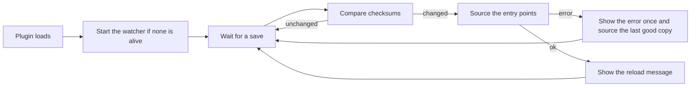

The watcher uses the first tool it finds, in this order: `fswatch`, `inotifywait`, `entr`; with none of them it checks every `@autoreload_revamped_interval` seconds. The checksum is one `cksum` run over every watched file.

The watcher records the tmux server's pid when it starts, and ends when that server is gone or a different server answers on the socket. One watcher runs per tmux server: loading the plugin again keeps a live watcher and replaces a dead one.

The last good copy of each entry point lives under `~/.tmux/autoreload-revamped/backup`, written when the watcher starts and after each reload that succeeds. `@autoreload_revamped_backup_dir` moves it.

<a id="screens"></a>

## Screens

<details>
<summary>Every screen, recorded inside a real tmux with <code>make screens</code>, with each key on the status line</summary>
<br>

<table>
<tr>
<td width="50%" valign="top">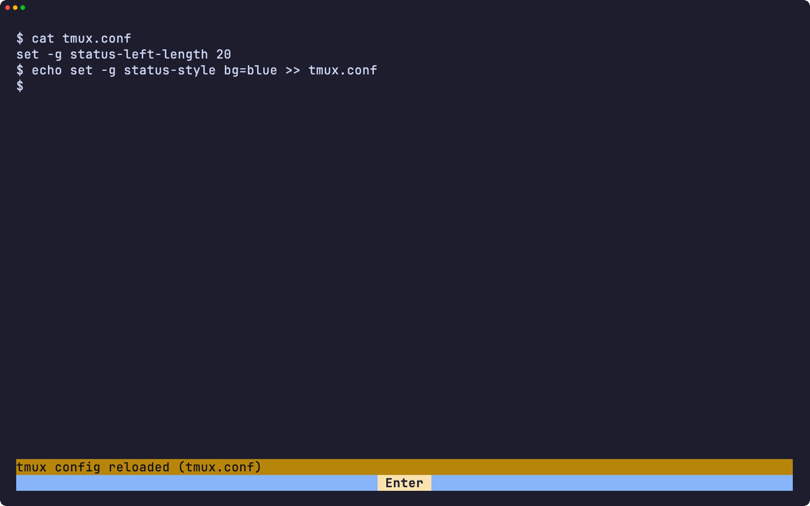<br><sub>A save reloads the config and says so in the status line, from <code>hero.tape</code></sub></td>
<td width="50%" valign="top">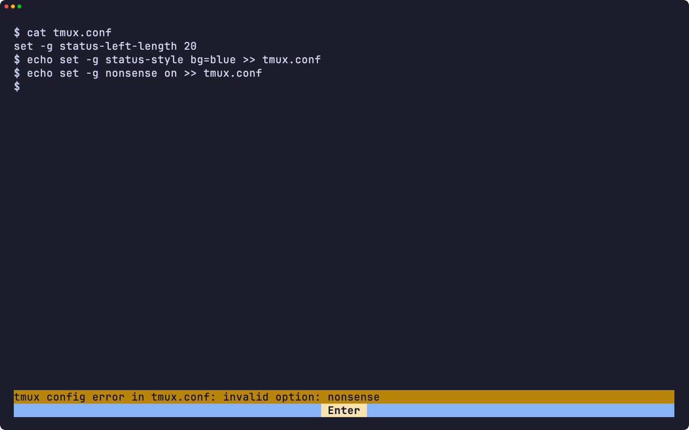<br><sub>A broken save shows tmux's error and keeps the last good copy, from <code>hero.tape</code></sub></td>
</tr>
<tr>
<td width="50%" valign="top">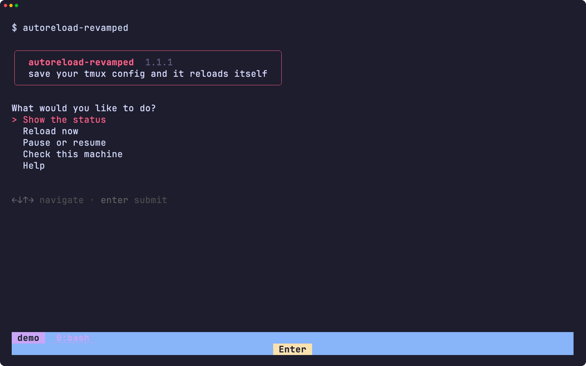<br><sub>The menu, from <code>hero.tape</code></sub></td>
<td width="50%" valign="top">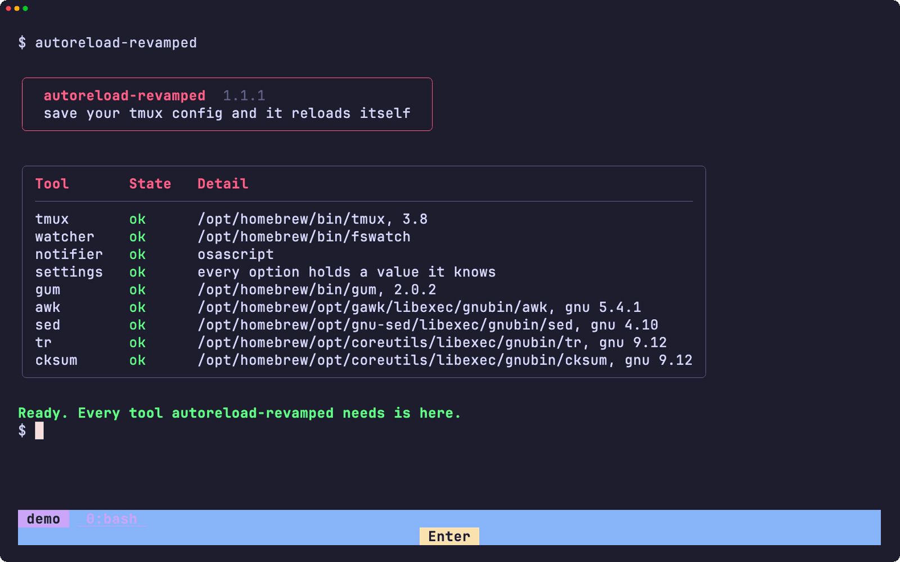<br><sub><code>doctor</code>, from <code>hero.tape</code></sub></td>
</tr>
<tr>
<td width="50%" valign="top">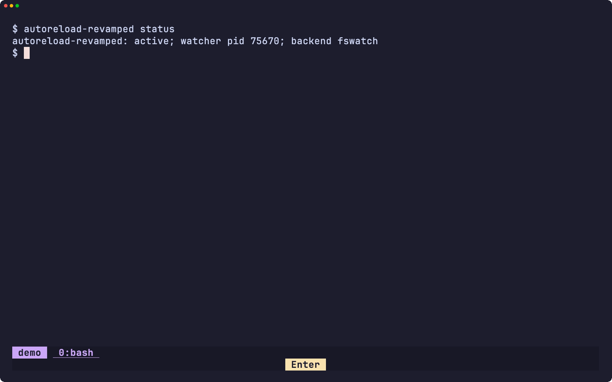<br><sub><code>status</code>, from <code>stills.tape</code></sub></td>
<td width="50%" valign="top">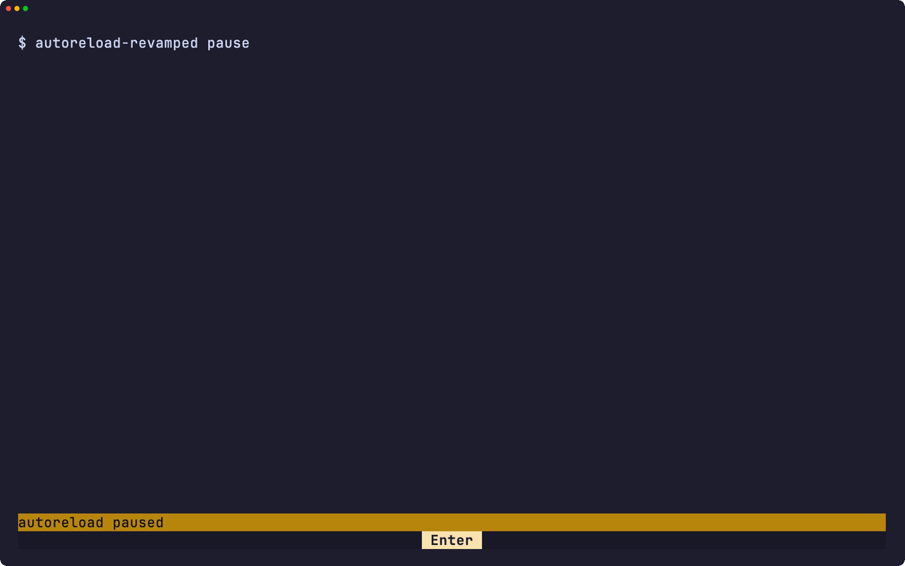<br><sub><code>pause</code> stops reacting to changes, from <code>stills.tape</code></sub></td>
</tr>
<tr>
<td width="50%" valign="top">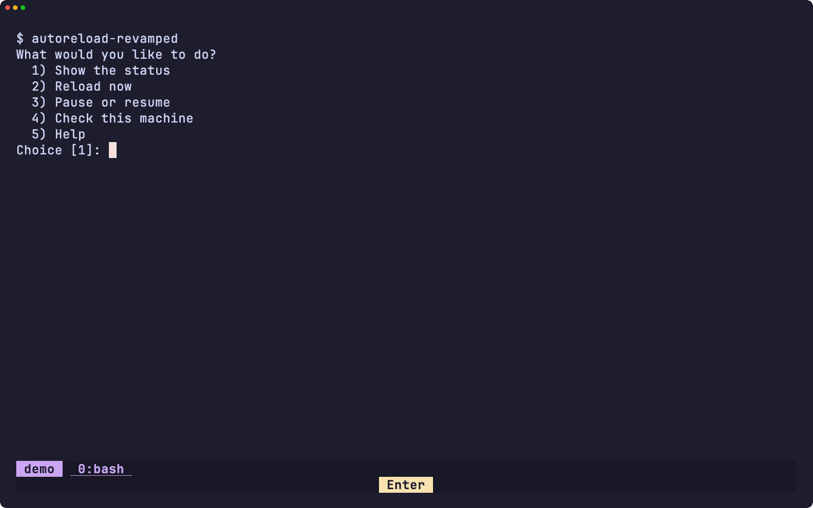<br><sub>The menu without gum, from <code>stills.tape</code></sub></td>
<td width="50%" valign="top">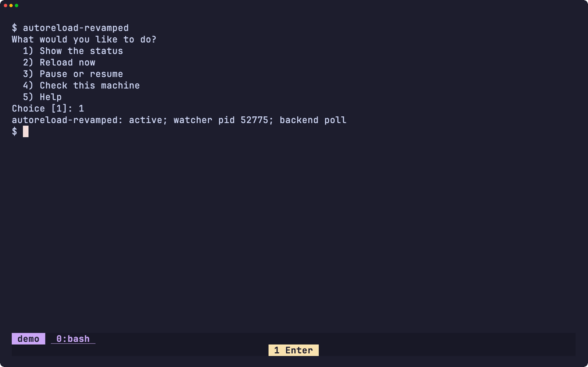<br><sub><code>status</code> from the menu, from <code>stills.tape</code></sub></td>
</tr>
<tr>
<td width="50%" valign="top">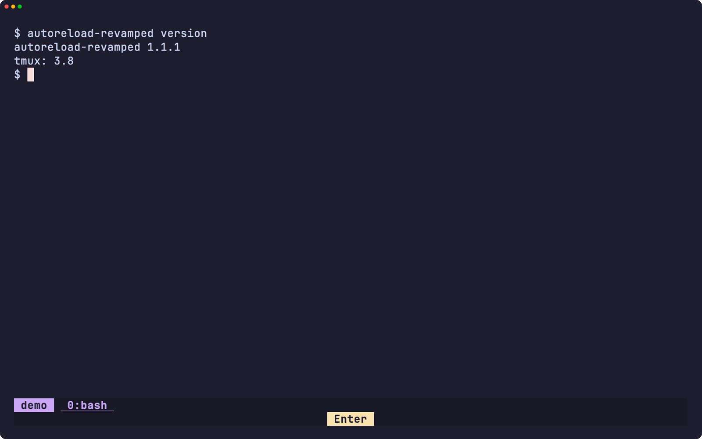<br><sub>The version, from <code>stills.tape</code></sub></td>
<td width="50%" valign="top">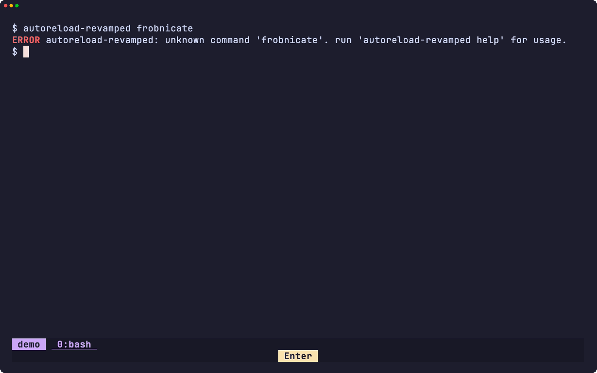<br><sub>An unknown command, from <code>stills.tape</code></sub></td>
</tr>
<tr>
<td width="50%" valign="top">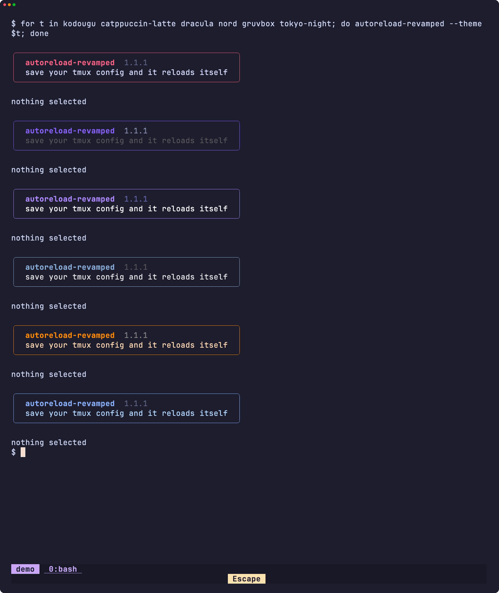<br><sub>The header in six themes, from <code>themes.tape</code></sub></td>
<td width="50%" valign="top">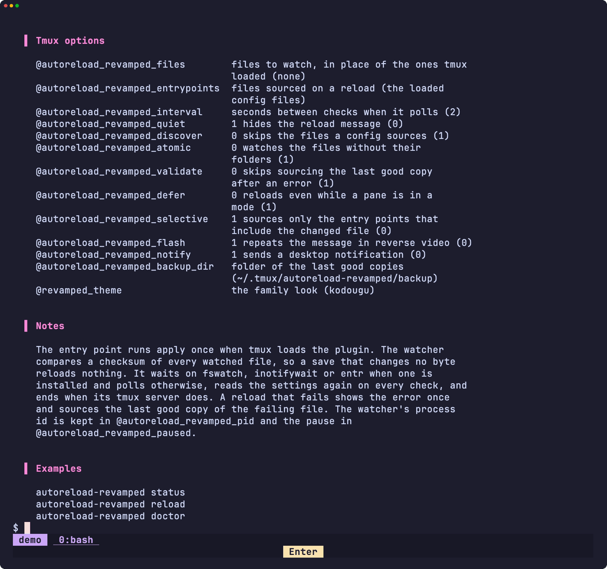<br><sub>The help page, from <code>help.tape</code></sub></td>
</tr>
<tr>
<td width="50%" valign="top">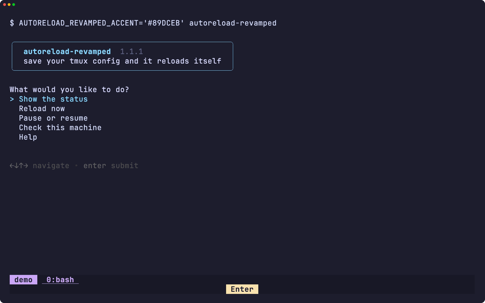<br><sub>An accent from <code>AUTORELOAD_REVAMPED_ACCENT</code>, from <code>stills.tape</code></sub></td>
<td width="50%" valign="top"></td>
</tr>
</table>

</details>

## Portability

The plugin is POSIX `sh`. CI runs every suite on each row below.

| Shell | Status |
|:------|:-------|
| `dash`, `/bin/sh` on macOS | Supported |
| `bash` 3.2 and 5.x, the system's `zsh` and Homebrew's | Supported |

| System | Status |
|:-------|:-------|
| macOS | Tahoe on Apple Silicon and Intel, with the tools it ships, Homebrew's GNU tools and Homebrew's uutils |
| Linux | Ubuntu 26.04 on x86_64 and arm64, with GNU coreutils, uutils and BusyBox |

## Development

| Command | What it runs |
|:--------|:-------------|
| `make fmt` | shfmt `-i 2` on every script |
| `make lint` | shfmt, ShellCheck, mandoc, yamllint and actionlint, at zero findings |
| `make test` | The bats suites under the system `sh` |
| `make test-all` | The suites under every installed shell, both builds of bash and zsh on macOS |
| `make test-linux` | The suites in an Ubuntu container |
| `make coverage` | bashcov on this Mac and in the Ubuntu container, merged and gated at 100 percent |
| `make screens` | The screens above, recorded from the real plugin inside tmux with VHS, on macOS |
| `make install` | The command, its man page and completions under `PREFIX` |

Commits follow the conventional commit format and go straight to `main`. After a green `ci` run on `main`, `release.yml` runs semantic-release: every `feat` or `fix` since the last tag publishes a release, stamps the version constant and adds the notes to [`CHANGELOG.md`](CHANGELOG.md).

## License

[MIT](LICENSE), copyright Gustavo Franco.

<!-- family:begin -->

## The tmux-revamped family

This plugin is one member of the tmux-revamped family. Every member carries the same contract in [`FAMILY.md`](FAMILY.md) and the same shared library, and they are built to be installed together: no member claims a key or a tmux option that another member claims.

A defect found in one member is hunted across all of them before the fix is called done.

| Member | What it does |
|---|---|
| [`tmux-autoreload-revamped`](https://github.com/tmux-revamped/tmux-autoreload-revamped) | **this plugin**, Edit your tmux config, save, and watch it reload itself, no key, no command |
| [`tmux-battery-revamped`](https://github.com/tmux-revamped/tmux-battery-revamped) | Battery status for your tmux status bar, without ever blocking the status render |
| [`tmux-bluetooth-revamped`](https://github.com/tmux-revamped/tmux-bluetooth-revamped) | Every connected Bluetooth device and its battery in your tmux status bar, without blocking the render |
| [`tmux-cpu-revamped`](https://github.com/tmux-revamped/tmux-cpu-revamped) | CPU load, temperature, and frequency in your tmux status bar, without ever blocking the render |
| [`tmux-disk-revamped`](https://github.com/tmux-revamped/tmux-disk-revamped) | Disk usage for your tmux status bar, without ever blocking the status render |
| [`tmux-extract-revamped`](https://github.com/tmux-revamped/tmux-extract-revamped) | Pick a URL, path, hash or any other token off the screen with fzf and type it at the cursor, in pure shell |
| [`tmux-fzf-revamped`](https://github.com/tmux-revamped/tmux-fzf-revamped) | Switch to, kill, rename or create tmux sessions, windows and panes from fzf pickers in a popup |
| [`tmux-git-revamped`](https://github.com/tmux-revamped/tmux-git-revamped) | Show the active pane's git branch, changes and provider counts in the tmux status bar without blocking it |
| [`tmux-gpu-revamped`](https://github.com/tmux-revamped/tmux-gpu-revamped) | GPU load, temperature, clock, power and memory in the tmux status bar, from NVIDIA, AMD, Intel and Apple GPUs |
| [`tmux-kube-revamped`](https://github.com/tmux-revamped/tmux-kube-revamped) | Current Kubernetes context and namespace in the tmux status bar, parsed from kubeconfig without kubectl |
| [`tmux-launcher-revamped`](https://github.com/tmux-revamped/tmux-launcher-revamped) | Open any terminal app in a tmux popup, window or split from one menu, starting at the project root |
| [`tmux-logging-revamped`](https://github.com/tmux-revamped/tmux-logging-revamped) | Capture any pane to a file: live logging, full scrollback, or a one-shot screenshot |
| [`tmux-music-revamped`](https://github.com/tmux-revamped/tmux-music-revamped) | Now playing in your tmux status bar, without ever blocking the status render |
| [`tmux-network-revamped`](https://github.com/tmux-revamped/tmux-network-revamped) | Network throughput in your tmux status bar, without ever blocking the render |
| [`tmux-pain-control-revamped`](https://github.com/tmux-revamped/tmux-pain-control-revamped) | Pane and window management bindings for tmux, version aware, vim friendly, every prefix key can be disabled |
| [`tmux-persist-revamped`](https://github.com/tmux-revamped/tmux-persist-revamped) | Save every tmux session, window and pane, auto-save on a timer, and restore it all after a reboot |
| [`tmux-plugin-template`](https://github.com/tmux-revamped/tmux-plugin-template) | The starting point for a tmux-revamped plugin: shared library, bats harness and CI |
| [`tmux-pomodoro-revamped`](https://github.com/tmux-revamped/tmux-pomodoro-revamped) | A Pomodoro timer in the tmux status bar that keeps all of its state in tmux options, with no temp files |
| [`tmux-ram-revamped`](https://github.com/tmux-revamped/tmux-ram-revamped) | RAM, swap and memory pressure in the tmux status bar, sampled in the background so the render never waits |
| [`tmux-reorder-revamped`](https://github.com/tmux-revamped/tmux-reorder-revamped) | Drag a window tab along the tmux status bar with the mouse to move that window |
| [`tmux-scroll-revamped`](https://github.com/tmux-revamped/tmux-scroll-revamped) | Send the mouse wheel to apps that scroll themselves and into tmux copy-mode everywhere else |
| [`tmux-sensible-revamped`](https://github.com/tmux-revamped/tmux-sensible-revamped) | Sensible tmux defaults, gated by tmux version and terminal, that leave the options you set alone |
| [`tmux-tiling-revamped`](https://github.com/tmux-revamped/tmux-tiling-revamped) | Tiling window management for tmux: eight layouts including BSP dwindle and spiral, with layout undo |
| [`tmux-time-revamped`](https://github.com/tmux-revamped/tmux-time-revamped) | Local and world clocks for the tmux status bar, colored by time of day, with countdowns and a DST warning |
| [`tmux-weather-revamped`](https://github.com/tmux-revamped/tmux-weather-revamped) | Weather for the tmux status bar from wttr.in, fetched in the background so the status line never waits |

<!-- family:end -->
