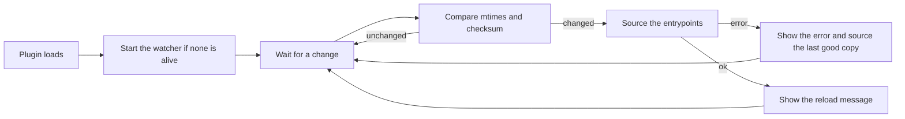

<div align="center">

# tmux-autoreload-revamped

<strong>Edit your tmux config, save, and watch it reload itself, no key, no command.</strong>

English &nbsp;|&nbsp; [日本語](README.ja.md) &nbsp;|&nbsp; [简体中文](README.zh-Hans.md) &nbsp;|&nbsp; [繁體中文（香港）](README.zh-HK.md)

[](https://github.com/tmux-revamped/tmux-autoreload-revamped/actions/workflows/tests.yml)
[](LICENSE)
[](CHANGELOG.md)

<p align="center">
  <a href="#what-it-does">What it does</a> &nbsp;|&nbsp;
  <a href="#requirements">Requirements</a> &nbsp;|&nbsp;
  <a href="#installation">Installation</a> &nbsp;|&nbsp;
  <a href="#usage">Usage</a> &nbsp;|&nbsp;
  <a href="#configuration">Configuration</a> &nbsp;|&nbsp;
  <a href="#key-bindings">Key bindings</a> &nbsp;|&nbsp;
  <a href="#how-it-works">How it works</a>
</p>

</div>

**4** watcher backends. **12** options. **5** subcommands. CI runs the suite on **10** Linux and macOS toolchain combinations.

---

## What it does

The plugin watches every config file tmux loaded, plus every file those files `source`. When one of them changes, it sources your config again and shows `tmux config reloaded (tmux.conf)` in the status line.

- A save that leaves the bytes unchanged does not reload, because the plugin compares a checksum of the content.
- An edit with an error shows the failing file and the tmux error message, then sources the last copy of that file that loaded cleanly.
- A change made while a pane is in copy-mode is held back, so a reload never interrupts a selection. The first check after every pane leaves its mode applies it: the next poll, or the next file event with a watcher tool.
- One watcher runs per tmux server. Loading the plugin again reuses a live watcher and replaces a dead one.

## Requirements

| Tool | Version | Needed for |
|:-----|:--------|:-----------|
| tmux | 3.2 or later | `#{config_files}`, which lists the loaded config files |
| bash | 3.2 or later | every script, including macOS `/bin/bash` |
| `fswatch`, `inotifywait` or `entr` | any | optional, event-driven reloads; without them the plugin polls |
| `osascript` or `notify-send` | any | optional, desktop notifications |

It runs on macOS and Linux, on x86_64 and arm64. File times are read with GNU `stat -c` first and BSD `stat -f` second, so it works with the macOS tools, GNU coreutils and uutils coreutils.

## Installation

### With TPM

Add the plugin to `~/.tmux.conf`, then press `prefix + I`:

```tmux
set -g @plugin 'tmux-revamped/tmux-autoreload-revamped'
```

### Manual

```bash
git clone https://github.com/tmux-revamped/tmux-autoreload-revamped ~/.tmux/plugins/tmux-autoreload-revamped
```

Then add this line to `~/.tmux.conf` and reload tmux once:

```tmux
run-shell ~/.tmux/plugins/tmux-autoreload-revamped/autoreload-revamped.tmux
```

## Usage

Save `~/.tmux.conf`, or any file it sources. tmux applies it on the next file event, or within `@autoreload_revamped_interval` seconds when no watcher tool is installed.

The script in [`src/autoreload.sh`](src/autoreload.sh) also takes subcommands:

| Subcommand | Effect |
|:-----------|:-------|
| `reload` | source the entrypoints now |
| `pause` | stop reacting to changes |
| `resume` | react to changes again |
| `toggle` | switch between paused and active |
| `status` | print the state, the watcher pid and the backend |

```bash
~/.tmux/plugins/tmux-autoreload-revamped/src/autoreload.sh status
```

```text
autoreload-revamped: active; watcher pid 48213; backend fswatch
```

## Configuration

| Option | Default | Meaning |
|:-------|:--------|:--------|
| `@autoreload_revamped_files` | empty | files to watch, comma or space separated, with `~` expanded; when set, it replaces the files tmux loaded |
| `@autoreload_revamped_entrypoints` | the loaded config files | files sourced on each reload |
| `@autoreload_revamped_interval` | `2` | seconds between checks when the plugin polls |
| `@autoreload_revamped_quiet` | `0` | `1` hides the reload message |
| `@autoreload_revamped_discover` | `1` | follows `source` and `source-file` lines, up to 8 levels deep; `0` watches only the top-level files |
| `@autoreload_revamped_atomic` | `1` | also watches each file's directory, so an editor that saves by renaming is caught; `0` watches the files only |
| `@autoreload_revamped_validate` | `1` | on a source error, sources the last good copy of the failing file; `0` skips the rollback |
| `@autoreload_revamped_defer` | `1` | waits while any pane is in copy-mode or another mode; `0` reloads at once |
| `@autoreload_revamped_selective` | `0` | `1` sources only the entrypoints whose include tree holds the changed file |
| `@autoreload_revamped_backoff_max` | `30` | longest wait in seconds between polls after repeated failed reloads |
| `@autoreload_revamped_flash` | `0` | `1` repeats the reload message in reverse video |
| `@autoreload_revamped_notify` | `0` | `1` sends a desktop notification on each reload |

```tmux
set -g @autoreload_revamped_files '~/.tmux.conf ~/.config/tmux/theme.conf'
set -g @autoreload_revamped_notify '1'
```

### Internal state

The plugin writes these options itself. Do not set them.

| Option | Holds |
|:-------|:------|
| `@autoreload_revamped_pid` | pid of the running watcher |
| `@autoreload_revamped_paused` | `1` while paused, `0` otherwise |
| `@autoreload_revamped_snapshot` | one `path mtime` line per watched file |
| `@autoreload_revamped_hash` | checksum of the content of every watched file |
| `@autoreload_revamped_fail_count` | failed reloads in a row, which lengthens the poll interval up to `@autoreload_revamped_backoff_max` |

## Key bindings

The plugin binds no key. To reload or pause from tmux, bind the subcommands yourself:

```tmux
bind R run-shell "~/.tmux/plugins/tmux-autoreload-revamped/src/autoreload.sh reload"
bind P run-shell "~/.tmux/plugins/tmux-autoreload-revamped/src/autoreload.sh toggle"
```

## How it works



The watcher picks the first tool it finds, in this order: `fswatch`, `inotifywait`, `entr`, then a polling loop. The polling loop doubles its wait after each failed reload, up to `@autoreload_revamped_backoff_max` seconds.

The watcher records the tmux server pid when it starts. It exits when that server is gone or a different server answers on the socket.

Backups of the entrypoints live under `~/.tmux/autoreload-revamped/backup`. The watcher writes them when it starts and after each reload that succeeds. Set `AR_CACHE_DIR` in the environment to move them.

## Development

| Command | What it runs |
|:--------|:-------------|
| `make test` | the bats suite under [`test/`](test) |
| `make lint` | shellcheck on every shell file |
| `make coverage` | kcov line coverage on Linux, failing below 95% |

The pure functions for watcher selection, change detection and path handling are in [`src/lib/autoreload/autoreload.sh`](src/lib/autoreload/autoreload.sh).

## License

[MIT](LICENSE), copyright Gustavo Franco.

<!-- family:begin -->

## The tmux-revamped family

This plugin is one member of the tmux-revamped family. Every member carries the
same contract in [`FAMILY.md`](FAMILY.md), the same tooling under `family/`, and
the same shared library, all held byte-identical by a checksum manifest. They are
built to be installed together: no member claims a key or a tmux option that
another member claims.

A defect found in one member is hunted across all of them before the fix is
called done. That obligation is written into the contract rather than left to
memory, and `family/bin/sweep` is how it is discharged.

| Member | What it does |
|---|---|
| [`tmux-autoreload-revamped`](https://github.com/tmux-revamped/tmux-autoreload-revamped) | **this plugin**, Edit your tmux config, save, and watch it reload itself, no key, no command |
| [`tmux-battery-revamped`](https://github.com/tmux-revamped/tmux-battery-revamped) | Battery status for your tmux status bar, without ever blocking the status render |
| [`tmux-bluetooth-revamped`](https://github.com/tmux-revamped/tmux-bluetooth-revamped) | Every connected Bluetooth device and its battery in your tmux status bar, without blocking the render |
| [`tmux-cpu-revamped`](https://github.com/tmux-revamped/tmux-cpu-revamped) | CPU load, temperature, and frequency in your tmux status bar, without ever blocking the render |
| [`tmux-disk-revamped`](https://github.com/tmux-revamped/tmux-disk-revamped) | Disk usage for your tmux status bar, without ever blocking the status render |
| [`tmux-extract-revamped`](https://github.com/tmux-revamped/tmux-extract-revamped) | Pick a URL, path, hash or any other token off the screen with fzf and type it at the cursor, in pure shell |
| [`tmux-fzf-revamped`](https://github.com/tmux-revamped/tmux-fzf-revamped) | Switch to, kill, rename or create tmux sessions, windows and panes from fzf pickers in a popup |
| [`tmux-git-revamped`](https://github.com/tmux-revamped/tmux-git-revamped) | Show the active pane's git branch, changes and provider counts in the tmux status bar without blocking it |
| [`tmux-gpu-revamped`](https://github.com/tmux-revamped/tmux-gpu-revamped) | GPU load, temperature, clock, power and memory in the tmux status bar, from NVIDIA, AMD, Intel and Apple GPUs |
| [`tmux-kube-revamped`](https://github.com/tmux-revamped/tmux-kube-revamped) | Current Kubernetes context and namespace in the tmux status bar, parsed from kubeconfig without kubectl |
| [`tmux-launcher-revamped`](https://github.com/tmux-revamped/tmux-launcher-revamped) | Launch any TUI app in a popup or a window, scoped to the current pane's directory, with one configurable bindi |
| [`tmux-logging-revamped`](https://github.com/tmux-revamped/tmux-logging-revamped) | Capture any pane to a file: live logging, full scrollback, or a one-shot screenshot |
| [`tmux-music-revamped`](https://github.com/tmux-revamped/tmux-music-revamped) | Now playing in your tmux status bar, without ever blocking the status render |
| [`tmux-network-revamped`](https://github.com/tmux-revamped/tmux-network-revamped) | Network throughput in your tmux status bar, without ever blocking the render |
| [`tmux-pain-control-revamped`](https://github.com/tmux-revamped/tmux-pain-control-revamped) | Standard pane and window management bindings for tmux, version aware, vim friendly, and fully configurable |
| [`tmux-persist-revamped`](https://github.com/tmux-revamped/tmux-persist-revamped) | Save every tmux session, window and pane, auto-save on a timer, and restore it all after a reboot |
| [`tmux-plugin-template`](https://github.com/tmux-revamped/tmux-plugin-template) | The starting point for a tmux-revamped plugin: shared library, bats harness, CI and family tooling |
| [`tmux-pomodoro-revamped`](https://github.com/tmux-revamped/tmux-pomodoro-revamped) | A Pomodoro timer in the tmux status bar that keeps all of its state in tmux options, with no temp files |
| [`tmux-ram-revamped`](https://github.com/tmux-revamped/tmux-ram-revamped) | RAM, swap and memory pressure in the tmux status bar, sampled in the background so the render never waits |
| [`tmux-reorder-revamped`](https://github.com/tmux-revamped/tmux-reorder-revamped) | Drag a window tab along the tmux status bar with the mouse to move that window |
| [`tmux-scroll-revamped`](https://github.com/tmux-revamped/tmux-scroll-revamped) | Send the mouse wheel to apps that scroll themselves and into tmux copy-mode everywhere else |
| [`tmux-sensible-revamped`](https://github.com/tmux-revamped/tmux-sensible-revamped) | Sensible tmux defaults, gated by tmux version and terminal, that leave the options you set alone |
| [`tmux-tiling-revamped`](https://github.com/tmux-revamped/tmux-tiling-revamped) | Tiling window management for tmux: eight layouts including BSP dwindle and spiral, with layout undo |
| [`tmux-time-revamped`](https://github.com/tmux-revamped/tmux-time-revamped) | Local and world clocks for the tmux status bar, colored by time of day, with countdowns and a DST warning |
| [`tmux-weather-revamped`](https://github.com/tmux-revamped/tmux-weather-revamped) | Weather for the tmux status bar from wttr.in, fetched in the background so the status line never waits |

### Checking an installation

With every member on disk, one command reports any conflict between them:

```sh
family/bin/doctor --live
```

It reads each member and the running tmux server, and reports duplicate keys,
duplicate status placeholders, options outside the naming grammar, and any
member whose contract version has fallen behind.

<!-- family:end -->
