<div align="center">

# tmux-autoreload-revamped

<strong>編輯並儲存 tmux 設定後，它會自動重新載入，毋須按鍵，也毋須指令。</strong>

[English](README.md) &nbsp;|&nbsp; [日本語](README.ja.md) &nbsp;|&nbsp; [简体中文](README.zh-Hans.md) &nbsp;|&nbsp; 繁體中文（香港）

[](https://github.com/tmux-revamped/tmux-autoreload-revamped/actions/workflows/ci.yml)
[](https://github.com/tmux-revamped/tmux-autoreload-revamped/releases/latest)
[](https://scorecard.dev/viewer/?uri=github.com/tmux-revamped/tmux-autoreload-revamped)
[](LICENSE)

<p align="center">
  <a href="#快速開始"><strong>快速開始</strong></a> &nbsp;|&nbsp;
  <a href="#用法">用法</a> &nbsp;|&nbsp;
  <a href="#運作原理">運作原理</a> &nbsp;|&nbsp;
  <a href="#畫面">畫面</a>
</p>

</div>

<p align="center">
  
</p>

```console
$ echo 'set -g status-style bg=blue' >> ~/.tmux.conf
$ autoreload-revamped status
autoreload-revamped: active; watcher pid 48213; backend fswatch
```

插件監視 tmux 載入的每個設定檔，以及這些檔案 `source` 的每個檔案。其中一個檔案儲存後內容有變時，它會重新載入設定，並在狀態列顯示 `tmux config reloaded (tmux.conf)`。位元組沒有變化的儲存不會重新載入；出錯的儲存只顯示一次 tmux 的錯誤，並重新載入上一份正常的副本；窗格處於複製模式時的修改會等到窗格離開該模式。

---

## 快速開始

### 前提條件

| 工具 | 版本 | 用途 |
|:-----|:--------|:---------|
| tmux | 3.2 或以上 | 系列的最低版本；列出已載入設定檔的 `#{config_files}` 亦需要它 |
| `fswatch`、`inotifywait` 或 `entr` | 可選 | 儲存的同時重新載入；沒有時插件每 `@autoreload_revamped_interval` 秒檢查一次 |
| `osascript` 或 `notify-send` | 可選 | 用於 `@autoreload_revamped_notify` |
| gum | 可選 | `autoreload-revamped` 的選單、表格和顏色；沒有它，所有命令都輸出純文字 |

### 安裝

```tmux
set -g @plugin 'tmux-revamped/tmux-autoreload-revamped'
```

然後按 `prefix + I`。不使用 TPM 時，複製儲存庫，並在 `~/.tmux.conf` 中執行它的入口腳本：

```bash
git clone https://github.com/tmux-revamped/tmux-autoreload-revamped ~/.tmux/plugins/tmux-autoreload-revamped
```

```tmux
run-shell ~/.tmux/plugins/tmux-autoreload-revamped/autoreload-revamped.tmux
```

在複製的目錄中執行 `make install`，亦會把 `autoreload-revamped` 放入 `~/.local/bin`，並把它的 man 手冊和自動完成放在 `~/.local/share` 下。

### 驗證

```bash
~/.tmux/plugins/tmux-autoreload-revamped/bin/autoreload-revamped doctor
```

## 用法

儲存 `~/.tmux.conf` 或它 source 的任何檔案即可。插件不綁定任何按鍵；需要按鍵時，自己綁定命令：

```tmux
bind-key <key> run-shell "~/.tmux/plugins/tmux-autoreload-revamped/bin/autoreload-revamped toggle"
```

| 命令 | 作用 |
|:--------|:-------------|
| `autoreload-revamped apply` | 沒有運作中的監視程序時啟動一個；插件載入時入口點會執行它 |
| `autoreload-revamped watch` | 監視設定檔，直至 tmux 伺服器結束；這就是 `apply` 留下的程序 |
| `autoreload-revamped reload` | 立即載入入口檔案 |
| `autoreload-revamped pause` | 停止回應修改 |
| `autoreload-revamped resume` | 恢復回應修改；暫停期間的儲存會在一個間隔內載入 |
| `autoreload-revamped toggle` | 在暫停和恢復之間切換 |
| `autoreload-revamped status` | 列出狀態、監視程序的 pid 和後端；`--json` 輸出一個物件 |
| `autoreload-revamped doctor` | 每個依賴一行，包括監視工具 |
| `autoreload-revamped version` | 版本，然後是 tmux 版本 |
| `autoreload-revamped help` | 說明頁；`man autoreload-revamped` 記錄相同的命令和設定 |
| `autoreload-revamped` | 在終端機上顯示選單 |

| tmux 選項 | 預設值 | 含義 |
|:------------|:--------|:--------|
| `@autoreload_revamped_files` | 無 | 要監視的檔案，用逗號或空格分隔，並展開 `~`；設定後取代 tmux 載入的檔案 |
| `@autoreload_revamped_entrypoints` | 已載入的設定檔 | 重新載入時 source 的檔案 |
| `@autoreload_revamped_interval` | `2` | 沒有監視工具時兩次檢查之間的秒數，亦是重試被延後或暫停的重新載入的間隔 |
| `@autoreload_revamped_quiet` | `0` | `1` 隱藏重新載入的訊息 |
| `@autoreload_revamped_discover` | `1` | 跟隨 `source` 和 `source-file` 行，最多 8 層；`0` 只監視頂層檔案 |
| `@autoreload_revamped_atomic` | `1` | 同時監視每個檔案所在的資料夾，這樣能捕捉到以重新命名方式儲存的編輯器；`0` 只監視檔案 |
| `@autoreload_revamped_validate` | `1` | 載入出錯時，載入出錯檔案上一份正常的副本；`0` 略過這一步 |
| `@autoreload_revamped_defer` | `1` | 任何窗格處於複製模式或其他模式時等待；`0` 立即重新載入 |
| `@autoreload_revamped_selective` | `0` | `1` 只載入包含被修改檔案的入口檔案 |
| `@autoreload_revamped_flash` | `0` | `1` 以反白再顯示一次重新載入的訊息 |
| `@autoreload_revamped_notify` | `0` | `1` 每次重新載入都發送桌面通知 |
| `@autoreload_revamped_backup_dir` | `~/.tmux/autoreload-revamped/backup` | 存放每個入口檔案上一份正常副本的資料夾 |

每個選項亦可以用帶連字號的命令選項（例如 `--interval 5`）和環境變數（例如 `AUTORELOAD_REVAMPED_INTERVAL`）設定；命令列優先於環境變數，環境變數優先於 tmux 選項。空的 tmux 選項表示預設值。`doctor` 會指出數值無法識別的設定。`@autoreload_revamped_pid` 和 `@autoreload_revamped_paused` 由插件自己寫入。

<a id="運作原理"></a>

## 運作原理

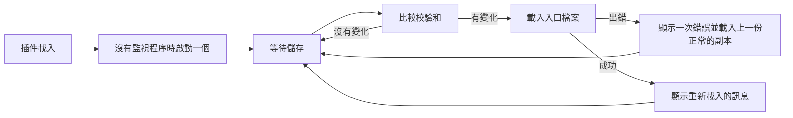

監視程序使用它找到的第一個工具，次序是 `fswatch`、`inotifywait`、`entr`；全部沒有時每 `@autoreload_revamped_interval` 秒檢查一次。校驗和是對所有被監視檔案執行一次 `cksum` 的結果。

監視程序啟動時記錄 tmux 伺服器的 pid，該伺服器結束，或者另一個伺服器在通訊端上回應時，它就會結束。每個 tmux 伺服器只執行一個監視程序：再次載入插件時，運作中的監視程序繼續使用，已經停止的會重新啟動。

每個入口檔案上一份正常的副本存放在 `~/.tmux/autoreload-revamped/backup`，在監視程序啟動時和每次重新載入成功後寫入。用 `@autoreload_revamped_backup_dir` 可以換一個位置。

<a id="畫面"></a>

## 畫面

<details>
<summary>所有畫面，在真實的 tmux 中用 <code>make screens</code> 錄製，每個按鍵顯示在狀態列上</summary>
<br>

<table>
<tr>
<td width="50%" valign="top">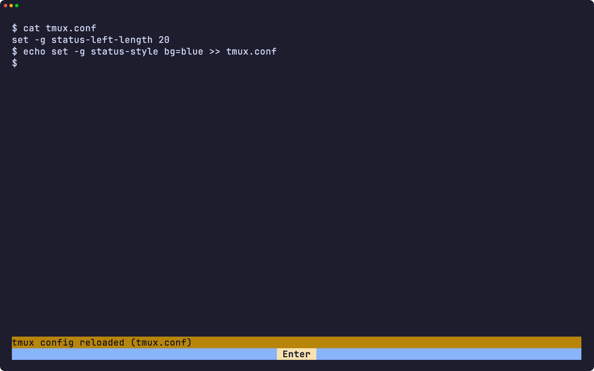<br><sub>儲存後重新載入設定，並在狀態列提示，來自 <code>hero.tape</code></sub></td>
<td width="50%" valign="top">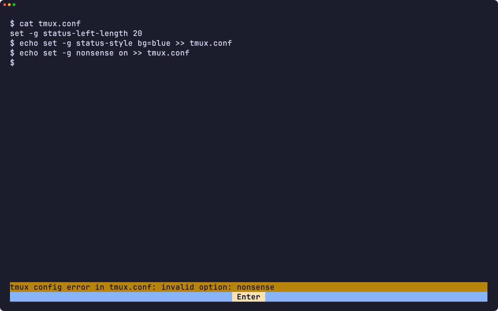<br><sub>出錯的儲存顯示 tmux 的錯誤，並保留上一份正常的副本，來自 <code>hero.tape</code></sub></td>
</tr>
<tr>
<td width="50%" valign="top">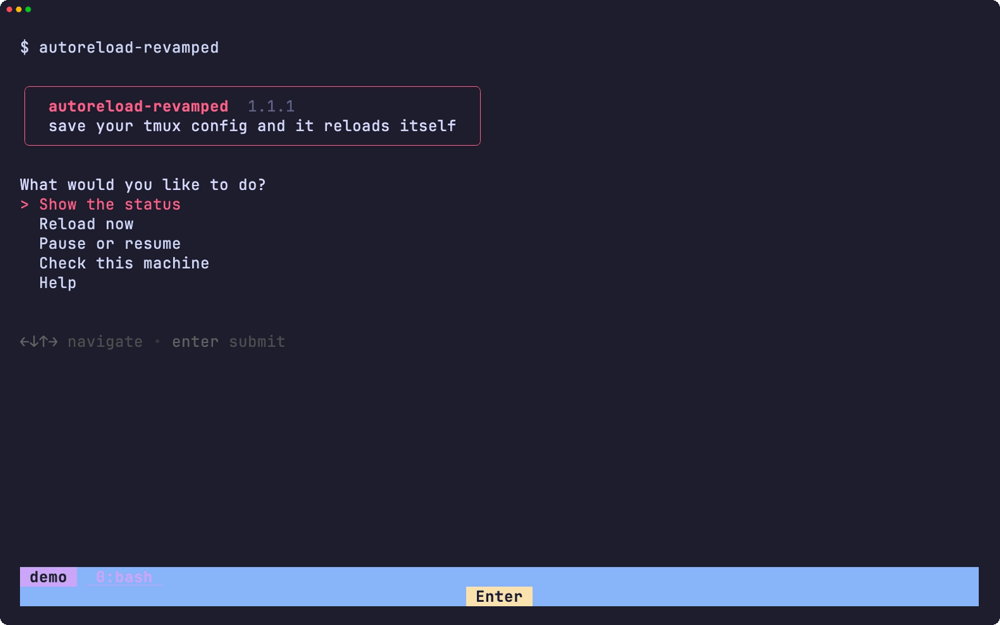<br><sub>選單，來自 <code>hero.tape</code></sub></td>
<td width="50%" valign="top">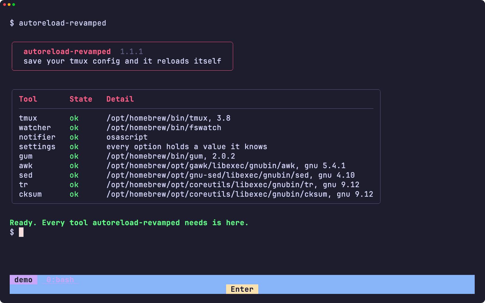<br><sub><code>doctor</code>，來自 <code>hero.tape</code></sub></td>
</tr>
<tr>
<td width="50%" valign="top">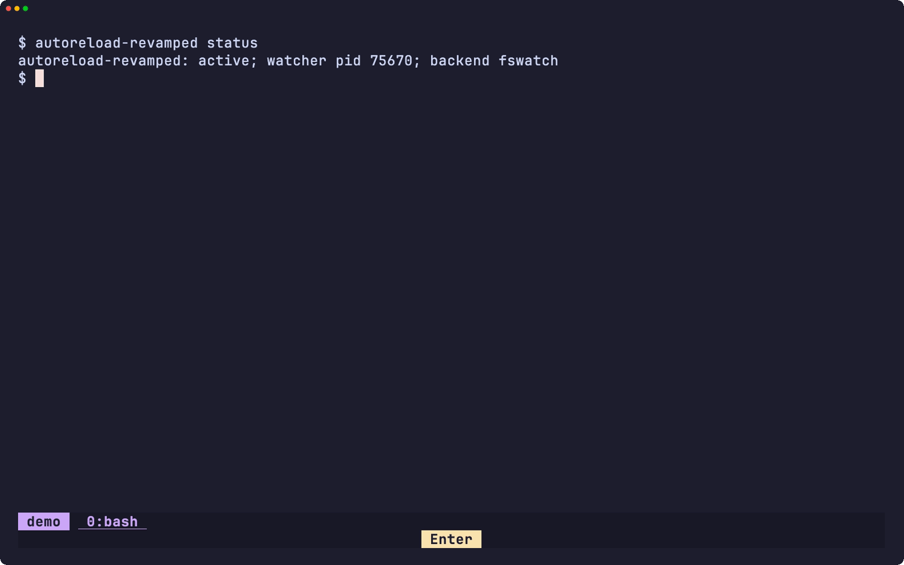<br><sub><code>status</code>，來自 <code>stills.tape</code></sub></td>
<td width="50%" valign="top">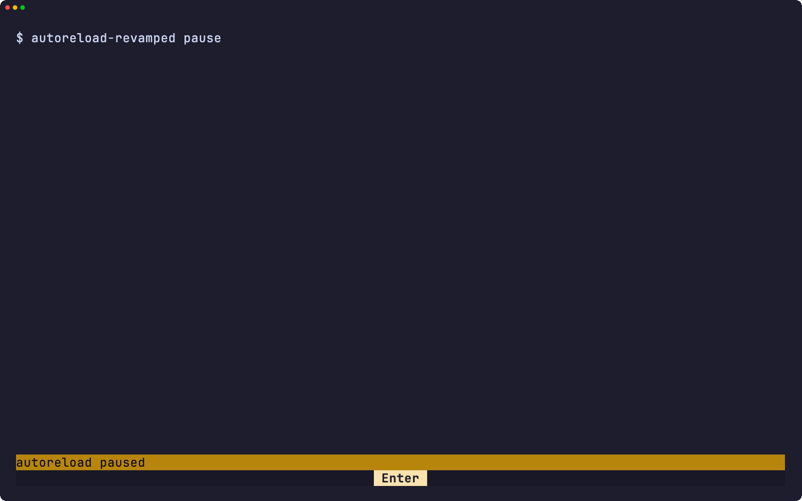<br><sub><code>pause</code> 停止回應修改，來自 <code>stills.tape</code></sub></td>
</tr>
<tr>
<td width="50%" valign="top">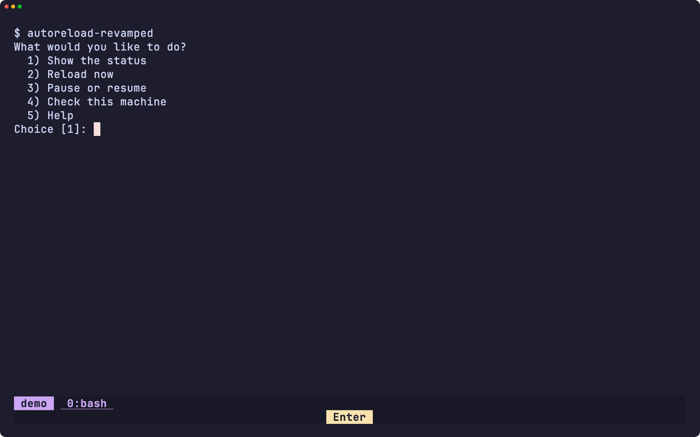<br><sub>沒有 gum 的選單，來自 <code>stills.tape</code></sub></td>
<td width="50%" valign="top">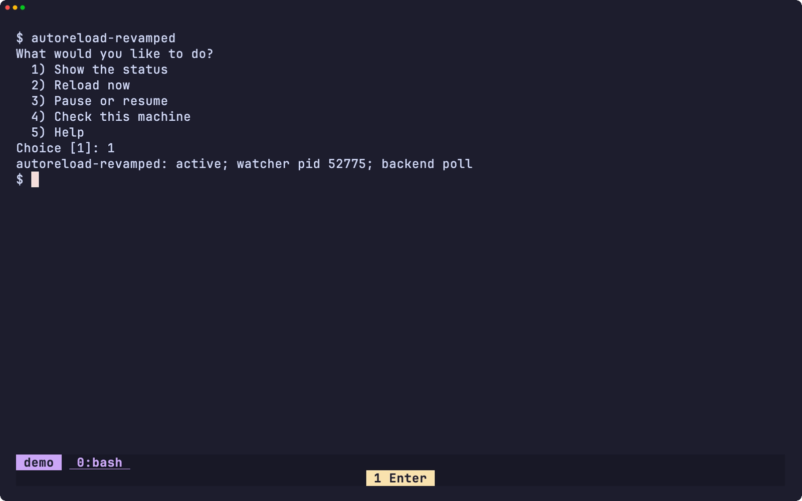<br><sub>從選單執行 <code>status</code>，來自 <code>stills.tape</code></sub></td>
</tr>
<tr>
<td width="50%" valign="top">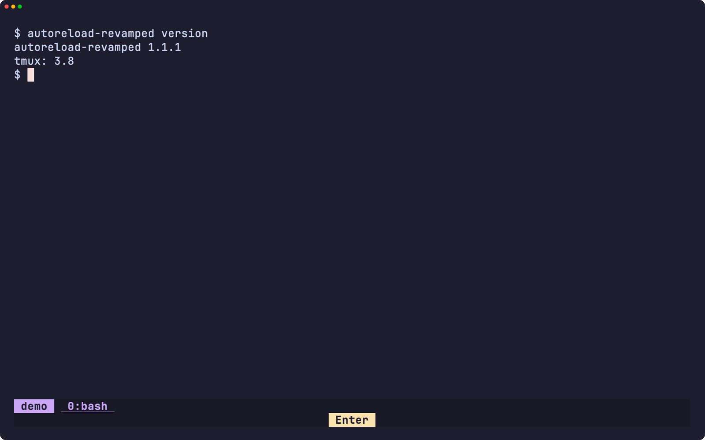<br><sub>版本，來自 <code>stills.tape</code></sub></td>
<td width="50%" valign="top">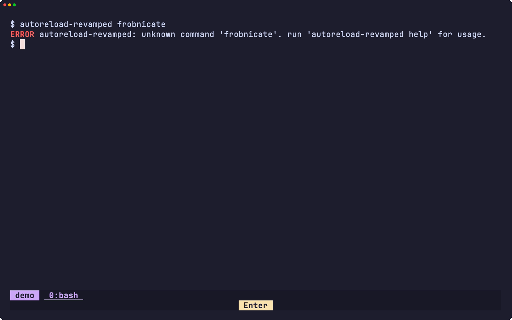<br><sub>不明命令，來自 <code>stills.tape</code></sub></td>
</tr>
<tr>
<td width="50%" valign="top">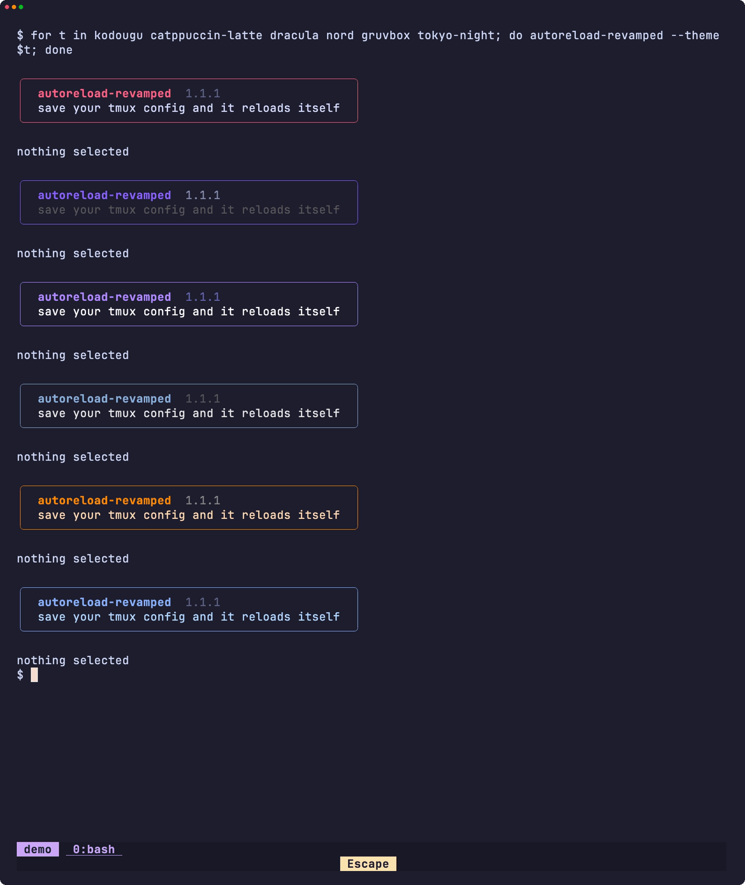<br><sub>六種主題下的標題，來自 <code>themes.tape</code></sub></td>
<td width="50%" valign="top">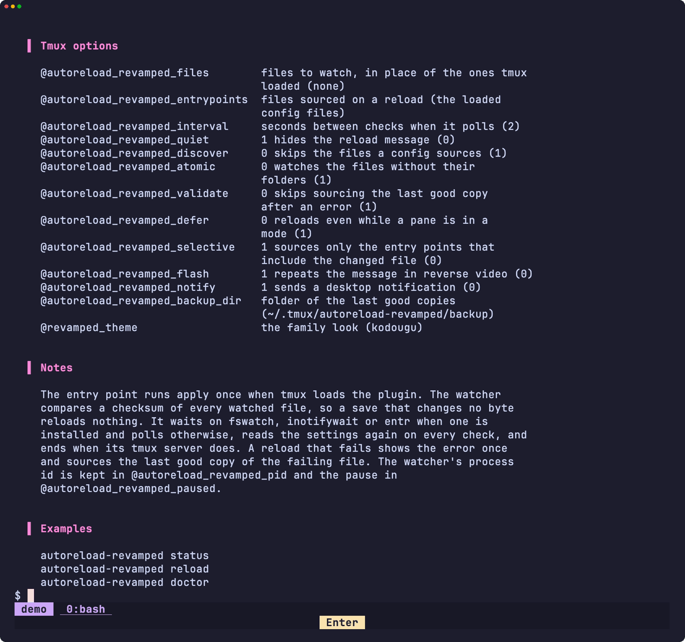<br><sub>說明頁，來自 <code>help.tape</code></sub></td>
</tr>
<tr>
<td width="50%" valign="top">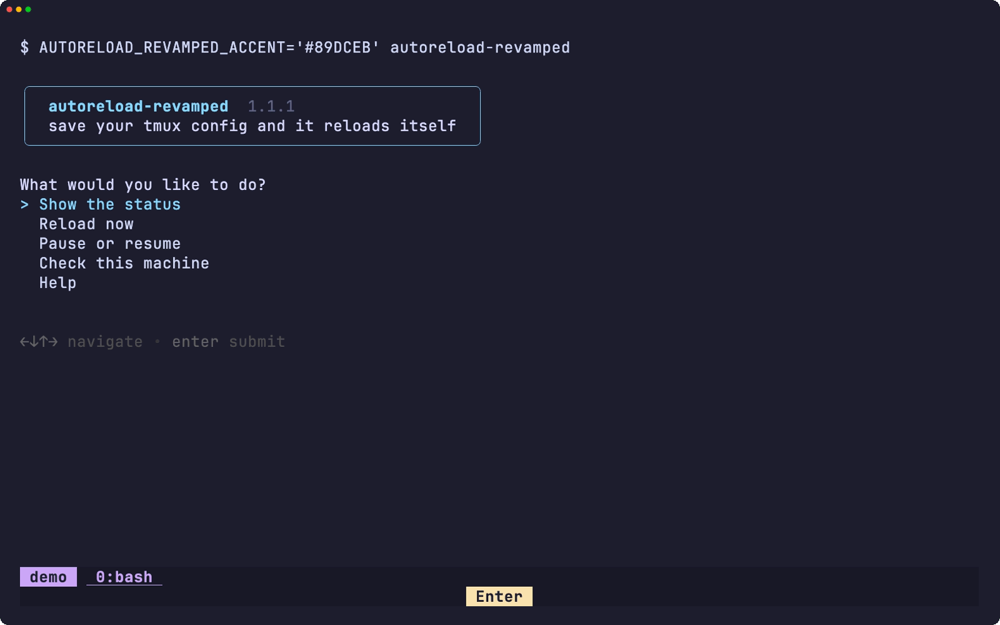<br><sub>來自 <code>AUTORELOAD_REVAMPED_ACCENT</code> 的強調色，來自 <code>stills.tape</code></sub></td>
<td width="50%" valign="top"></td>
</tr>
</table>

</details>

## 可攜性

插件是 POSIX `sh`。CI 在下列每一行上執行全部測試。

| Shell | 狀態 |
|:------|:-------|
| `dash`、macOS 上的 `/bin/sh` | 支援 |
| `bash` 3.2 和 5.x、系統內建的 `zsh` 和 Homebrew 的 `zsh` | 支援 |

| 系統 | 狀態 |
|:-------|:-------|
| macOS | Apple Silicon 和 Intel 上的 Tahoe，使用內建的工具、Homebrew 的 GNU 工具和 Homebrew 的 uutils |
| Linux | x86_64 和 arm64 上的 Ubuntu 26.04，使用 GNU coreutils、uutils 和 BusyBox |

## 開發

| 指令 | 執行內容 |
|:--------|:-------------|
| `make fmt` | 對每個腳本執行 shfmt `-i 2` |
| `make lint` | shfmt、ShellCheck、mandoc、yamllint 和 actionlint，零警告 |
| `make test` | 在系統 `sh` 下執行 bats 測試 |
| `make test-all` | 在每個已安裝的 shell 下執行測試，macOS 上包括 bash 和 zsh 的兩種版本 |
| `make test-linux` | 在 Ubuntu 容器中執行測試 |
| `make coverage` | 在這部 Mac 和 Ubuntu 容器中執行 bashcov，合併後以 100% 為門檻 |
| `make screens` | 以 VHS 在 tmux 中從真實插件錄製上述畫面，在 macOS 上執行 |
| `make install` | 把指令、man 手冊和自動完成安裝到 `PREFIX` 下 |

在 macOS 上，執行 `brew bundle` 會根據 [`Brewfile`](Brewfile) 安裝這些目標用到的所有工具。

提交遵循 Conventional Commits 格式，直接進入 `main`。`main` 上的 `ci` 通過後，`release.yml` 會執行 semantic-release：自上一個標籤以來的每個 `feat` 或 `fix` 都會發佈新版本，更新版本常數，並把說明寫入 [`CHANGELOG.md`](CHANGELOG.md)。

## 授權

[MIT](LICENSE)，copyright Gustavo Franco。

<!-- family:begin -->

## tmux-revamped 插件家族

這個插件是 tmux-revamped 插件家族的一員。每個成員都帶有 [`FAMILY.md`](FAMILY.md) 中相同的約定和相同的共用程式庫，並且設計為一起安裝：沒有成員佔用另一個成員佔用的按鍵或 tmux 選項。

在一個成員中發現的缺陷，要在全部成員中排查後才算修正完成。

| 成員 | 功能 |
|---|---|
| [`tmux-autoreload-revamped`](https://github.com/tmux-revamped/tmux-autoreload-revamped) | **本插件**，編輯並儲存 tmux 設定後，它會自動重新載入，毋須按鍵，也毋須指令 |
| [`tmux-battery-revamped`](https://github.com/tmux-revamped/tmux-battery-revamped) | 在 tmux 狀態列顯示電池狀態，從不阻塞狀態列繪製 |
| [`tmux-bluetooth-revamped`](https://github.com/tmux-revamped/tmux-bluetooth-revamped) | 在 tmux 狀態列顯示每部已連接的藍牙裝置及其電量，不阻塞繪製 |
| [`tmux-cpu-revamped`](https://github.com/tmux-revamped/tmux-cpu-revamped) | 在 tmux 狀態列顯示 CPU 負載、溫度及頻率，從不阻塞繪製 |
| [`tmux-disk-revamped`](https://github.com/tmux-revamped/tmux-disk-revamped) | 在 tmux 狀態列顯示磁碟用量，從不阻塞狀態列繪製 |
| [`tmux-extract-revamped`](https://github.com/tmux-revamped/tmux-extract-revamped) | 用 fzf 從畫面上揀選 URL、路徑、雜湊值或任何其他字詞，並輸入到游標位置，全部以純 shell 實現 |
| [`tmux-fzf-revamped`](https://github.com/tmux-revamped/tmux-fzf-revamped) | 在彈出視窗的 fzf 選擇器中切換、關閉、重新命名或建立 tmux 工作階段、視窗和窗格 |
| [`tmux-git-revamped`](https://github.com/tmux-revamped/tmux-git-revamped) | 在 tmux 狀態列顯示當前窗格的 git 分支、改動和託管平台數目，而不會阻塞顯示 |
| [`tmux-gpu-revamped`](https://github.com/tmux-revamped/tmux-gpu-revamped) | 在 tmux 狀態列顯示 NVIDIA、AMD、Intel 及 Apple GPU 的負載、溫度、時脈、功耗及記憶體 |
| [`tmux-kube-revamped`](https://github.com/tmux-revamped/tmux-kube-revamped) | 在 tmux 狀態列顯示目前的 Kubernetes 上下文及命名空間，毋須 kubectl，直接解析 kubeconfig |
| [`tmux-launcher-revamped`](https://github.com/tmux-revamped/tmux-launcher-revamped) | 在彈出視窗或新視窗中啟動任何 TUI 應用程式，從目前窗格的目錄開始，每個應用程式可設定一個按鍵 |
| [`tmux-logging-revamped`](https://github.com/tmux-revamped/tmux-logging-revamped) | 將任何窗格儲存到檔案：即時記錄、完整捲動緩衝區或一次性截圖 |
| [`tmux-music-revamped`](https://github.com/tmux-revamped/tmux-music-revamped) | 在 tmux 狀態列顯示正在播放的歌曲，從不阻塞狀態列的繪製 |
| [`tmux-network-revamped`](https://github.com/tmux-revamped/tmux-network-revamped) | 在 tmux 狀態列顯示網絡傳輸量，從不阻塞繪製 |
| [`tmux-pain-control-revamped`](https://github.com/tmux-revamped/tmux-pain-control-revamped) | tmux 的窗格和視窗管理按鍵，配合 tmux 版本，與 vim 相容，每個 prefix 按鍵都可停用 |
| [`tmux-persist-revamped`](https://github.com/tmux-revamped/tmux-persist-revamped) | 儲存 tmux 的所有工作階段、視窗及窗格，按計時器自動儲存，並在重新開機後全部還原 |
| [`tmux-plugin-template`](https://github.com/tmux-revamped/tmux-plugin-template) | tmux-revamped 插件的起點：共用程式庫、bats 測試框架和 CI |
| [`tmux-pomodoro-revamped`](https://github.com/tmux-revamped/tmux-pomodoro-revamped) | tmux 狀態列中的番茄鐘計時器，所有狀態都儲存在 tmux 選項中，不使用暫存檔 |
| [`tmux-ram-revamped`](https://github.com/tmux-revamped/tmux-ram-revamped) | 在 tmux 狀態列顯示記憶體、交換空間及記憶體壓力，在背景取樣，繪製從不等待 |
| [`tmux-reorder-revamped`](https://github.com/tmux-revamped/tmux-reorder-revamped) | 用滑鼠在 tmux 狀態列上拖動視窗標籤來移動該視窗 |
| [`tmux-scroll-revamped`](https://github.com/tmux-revamped/tmux-scroll-revamped) | 將滑鼠滾輪交給能自行捲動的應用程式，其他情況下進入 tmux 複製模式 |
| [`tmux-sensible-revamped`](https://github.com/tmux-revamped/tmux-sensible-revamped) | 按 tmux 版本和終端機區分的合理預設設定，不會改動你自己設定的選項 |
| [`tmux-tiling-revamped`](https://github.com/tmux-revamped/tmux-tiling-revamped) | tmux 的平鋪視窗管理：八種版面，包括 BSP dwindle 和 spiral，並支援復原版面 |
| [`tmux-time-revamped`](https://github.com/tmux-revamped/tmux-time-revamped) | 狀態列中的本地時鐘和世界時鐘，按一天中的時段著色，並提供倒數和夏令時間提示 |
| [`tmux-weather-revamped`](https://github.com/tmux-revamped/tmux-weather-revamped) | 在背景從 wttr.in 取得天氣並顯示在狀態列，狀態列毋須等待 |

<!-- family:end -->
