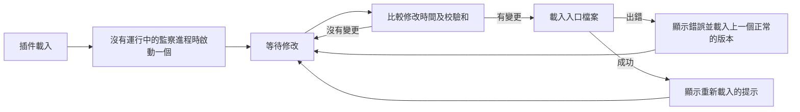

<div align="center">

# tmux-autoreload-revamped

<strong>編輯並儲存 tmux 設定後，它會自動重新載入，毋須按鍵，也毋須指令。</strong>

[English](README.md) | [日本語](README.ja.md) | [简体中文](README.zh-Hans.md) | 繁體中文（香港）

[](https://github.com/tmux-revamped/tmux-autoreload-revamped/actions/workflows/tests.yml)
[](LICENSE)
[](CHANGELOG.md)

<p align="center">
  <a href="#what-it-does">功能</a> |
  <a href="#requirements">系統要求</a> |
  <a href="#installation">安裝</a> |
  <a href="#usage">用法</a> |
  <a href="#configuration">設定</a> |
  <a href="#key-bindings">快捷鍵</a> |
  <a href="#how-it-works">運作原理</a>
</p>

</div>

**4** 種監察後端。**12** 個選項。**5** 個子指令。CI 在 **10** 種 Linux 及 macOS 工具鏈組合上執行測試。

---

<a id="what-it-does"></a>

## 功能

插件監察 tmux 載入的每個設定檔，以及這些檔案透過 `source` 引入的每個檔案。其中任何一個有變更時，它會重新載入設定，並在狀態列顯示 `tmux config reloaded (tmux.conf)`。

- 插件比較內容的校驗和，因此位元組沒有改變的儲存不會觸發重新載入。
- 含有錯誤的修改會顯示出錯的檔案及 tmux 的錯誤訊息，然後重新載入該檔案上一次成功載入的版本。
- 窗格處於複製模式時的修改會被暫緩，所以重新載入不會打斷選取操作。所有窗格離開模式後的第一次檢查會套用它：輪詢時是下一個週期，有監察工具時是下一個檔案事件。
- 每個 tmux 伺服器只執行一個監察進程。再次載入插件時，仍在運行的監察進程會繼續使用，已停止的會被取代。

<a id="requirements"></a>

## 系統要求

| 工具 | 版本 | 用途 |
|:-----|:--------|:-----------|
| tmux | 3.2 或以上 | `#{config_files}`，列出已載入的設定檔 |
| bash | 3.2 或以上 | 所有腳本，包括 macOS 的 `/bin/bash` |
| `fswatch`、`inotifywait` 或 `entr` | 任何 | 可選，以事件驅動重新載入；全部沒有時插件改用輪詢 |
| `osascript` 或 `notify-send` | 任何 | 可選，桌面通知 |

支援 macOS 及 Linux，x86_64 及 arm64。檔案修改時間先以 GNU 的 `stat -c` 讀取，再以 BSD 的 `stat -f` 讀取，因此在 macOS 內置工具、GNU coreutils 及 uutils coreutils 上都能運行。

<a id="installation"></a>

## 安裝

### 使用 TPM

把插件加入 `~/.tmux.conf`，然後按 `prefix + I`：

```tmux
set -g @plugin 'tmux-revamped/tmux-autoreload-revamped'
```

### 手動安裝

```bash
git clone https://github.com/tmux-revamped/tmux-autoreload-revamped ~/.tmux/plugins/tmux-autoreload-revamped
```

然後在 `~/.tmux.conf` 加入這一行，並重新載入 tmux 一次：

```tmux
run-shell ~/.tmux/plugins/tmux-autoreload-revamped/autoreload-revamped.tmux
```

<a id="usage"></a>

## 用法

儲存 `~/.tmux.conf` 或它引入的任何檔案。tmux 會在下一個檔案事件時套用設定；沒有安裝監察工具時，會在 `@autoreload_revamped_interval` 秒內套用。

[`src/autoreload.sh`](src/autoreload.sh) 中的腳本亦支援子指令：

| 子指令 | 作用 |
|:-----------|:-------|
| `reload` | 立即載入入口檔案 |
| `pause` | 停止回應修改 |
| `resume` | 恢復回應修改 |
| `toggle` | 在暫停及運行之間切換 |
| `status` | 輸出狀態、監察進程的 pid 及後端 |

```bash
~/.tmux/plugins/tmux-autoreload-revamped/src/autoreload.sh status
```

```text
autoreload-revamped: active; watcher pid 48213; backend fswatch
```

<a id="configuration"></a>

## 設定

| 選項 | 預設值 | 意思 |
|:-------|:--------|:--------|
| `@autoreload_revamped_files` | 空 | 要監察的檔案，以逗號或空格分隔，支援 `~` 展開；設定後會取代 tmux 載入的檔案 |
| `@autoreload_revamped_entrypoints` | 已載入的設定檔 | 每次重新載入時載入的檔案 |
| `@autoreload_revamped_interval` | `2` | 輪詢時兩次檢查之間的秒數 |
| `@autoreload_revamped_quiet` | `0` | `1` 隱藏重新載入的提示 |
| `@autoreload_revamped_discover` | `1` | 跟隨 `source` 及 `source-file` 行，最多 8 層；`0` 只監察頂層檔案 |
| `@autoreload_revamped_atomic` | `1` | 同時監察每個檔案所在的目錄，以捕捉透過重新命名來儲存的編輯器；`0` 只監察檔案 |
| `@autoreload_revamped_validate` | `1` | 載入出錯時，載入出錯檔案上一個正常的版本；`0` 不還原 |
| `@autoreload_revamped_defer` | `1` | 有窗格處於複製模式或其他模式時等待；`0` 立即重新載入 |
| `@autoreload_revamped_selective` | `0` | `1` 只載入包含被修改檔案的入口檔案 |
| `@autoreload_revamped_backoff_max` | `30` | 連續重新載入失敗後，輪詢間隔的最長秒數 |
| `@autoreload_revamped_flash` | `0` | `1` 以反白再次顯示重新載入的提示 |
| `@autoreload_revamped_notify` | `0` | `1` 每次重新載入時發出桌面通知 |

```tmux
set -g @autoreload_revamped_files '~/.tmux.conf ~/.config/tmux/theme.conf'
set -g @autoreload_revamped_notify '1'
```

### 內部狀態

以下選項由插件自行寫入，請勿設定。

| 選項 | 內容 |
|:-------|:------|
| `@autoreload_revamped_pid` | 正在運行的監察進程的 pid |
| `@autoreload_revamped_paused` | 暫停時為 `1`，否則為 `0` |
| `@autoreload_revamped_snapshot` | 每個被監察檔案一行 `path mtime` |
| `@autoreload_revamped_hash` | 所有被監察檔案內容的校驗和 |
| `@autoreload_revamped_fail_count` | 連續失敗的重新載入次數，會把輪詢間隔延長至 `@autoreload_revamped_backoff_max` |

<a id="key-bindings"></a>

## 快捷鍵

插件不綁定任何按鍵。如要在 tmux 中重新載入或暫停，請自行綁定子指令：

```tmux
bind R run-shell "~/.tmux/plugins/tmux-autoreload-revamped/src/autoreload.sh reload"
bind P run-shell "~/.tmux/plugins/tmux-autoreload-revamped/src/autoreload.sh toggle"
```

<a id="how-it-works"></a>

## 運作原理



監察進程按 `fswatch`、`inotifywait`、`entr` 的次序使用第一個找到的工具，全部沒有時使用輪詢。每次重新載入失敗後，輪詢的等待時間加倍，最長 `@autoreload_revamped_backoff_max` 秒。

監察進程啟動時記錄 tmux 伺服器的 pid。該伺服器結束，或通訊端上換成另一個伺服器回應時，監察進程便會結束。

入口檔案的備份位於 `~/.tmux/autoreload-revamped/backup`。監察進程在啟動時及每次重新載入成功後寫入備份。設定環境變數 `AR_CACHE_DIR` 可以更改位置。

<a id="development"></a>

## 開發

| 指令 | 執行內容 |
|:--------|:-------------|
| `make test` | [`test/`](test) 下的 bats 測試 |
| `make lint` | 對所有 shell 檔案執行 shellcheck |
| `make coverage` | 在 Linux 上以 kcov 計算行覆蓋率，低於 95% 時失敗 |

選擇監察工具、偵測修改及處理路徑的純函數位於 [`src/lib/autoreload/autoreload.sh`](src/lib/autoreload/autoreload.sh)。

<a id="license"></a>

## 授權

[MIT](LICENSE)，copyright Gustavo Franco。

<!-- family:begin -->

## tmux-revamped 插件家族

本插件是 tmux-revamped 插件家族的成員。每個成員都帶有 [`FAMILY.md`](FAMILY.md) 中的同一份約定、`family/` 下的同一套工具和同一個共用程式庫，並由校驗和清單確保逐位元組一致。這些成員可以一併安裝：任何成員都不會佔用其他成員使用的按鍵或 tmux 選項。

在一個成員中發現的缺陷，要在全部成員中排查後才算修正完成。這項責任寫在約定之中，而不是依靠記憶，`family/bin/sweep` 負責執行。

| 成員 | 功能 |
|---|---|
| [`tmux-autoreload-revamped`](https://github.com/tmux-revamped/tmux-autoreload-revamped) | **本插件**，編輯並儲存 tmux 設定後，它會自動重新載入，毋須按鍵，也毋須指令 |
| [`tmux-battery-revamped`](https://github.com/tmux-revamped/tmux-battery-revamped) | 在 tmux 狀態列顯示電池狀態，從不阻塞狀態列繪製 |
| [`tmux-bluetooth-revamped`](https://github.com/tmux-revamped/tmux-bluetooth-revamped) | 在 tmux 狀態列顯示每部已連接的藍牙裝置及其電量，不阻塞繪製 |
| [`tmux-cpu-revamped`](https://github.com/tmux-revamped/tmux-cpu-revamped) | 在 tmux 狀態列顯示 CPU 負載、溫度及頻率，從不阻塞繪製 |
| [`tmux-disk-revamped`](https://github.com/tmux-revamped/tmux-disk-revamped) | 在 tmux 狀態列顯示磁碟用量，從不阻塞狀態列繪製 |
| [`tmux-extract-revamped`](https://github.com/tmux-revamped/tmux-extract-revamped) | 用 fzf 從畫面上揀選 URL、路徑、雜湊值或任何其他字詞，並輸入到游標位置，全部以純 shell 實現 |
| [`tmux-fzf-revamped`](https://github.com/tmux-revamped/tmux-fzf-revamped) | 在彈出視窗的 fzf 選擇器中切換、關閉、重新命名或建立 tmux 工作階段、視窗和窗格 |
| [`tmux-git-revamped`](https://github.com/tmux-revamped/tmux-git-revamped) | 在 tmux 狀態列顯示當前窗格的 git 分支、改動和託管平台數目，而不會阻塞顯示 |
| [`tmux-gpu-revamped`](https://github.com/tmux-revamped/tmux-gpu-revamped) | 在 tmux 狀態列顯示 NVIDIA、AMD、Intel 及 Apple GPU 的負載、溫度、時脈、功耗及記憶體 |
| [`tmux-kube-revamped`](https://github.com/tmux-revamped/tmux-kube-revamped) | 在 tmux 狀態列顯示目前的 Kubernetes 上下文及命名空間，毋須 kubectl，直接解析 kubeconfig |
| [`tmux-launcher-revamped`](https://github.com/tmux-revamped/tmux-launcher-revamped) | 在彈出視窗或新視窗中啟動任何 TUI 應用程式，從目前窗格的目錄開始，每個應用程式可設定一個按鍵 |
| [`tmux-logging-revamped`](https://github.com/tmux-revamped/tmux-logging-revamped) | 將任何窗格儲存到檔案：即時記錄、完整捲動緩衝區或一次性截圖 |
| [`tmux-music-revamped`](https://github.com/tmux-revamped/tmux-music-revamped) | 在 tmux 狀態列顯示正在播放的歌曲，從不阻塞狀態列的繪製 |
| [`tmux-network-revamped`](https://github.com/tmux-revamped/tmux-network-revamped) | 在 tmux 狀態列顯示網絡傳輸量，從不阻塞繪製 |
| [`tmux-pain-control-revamped`](https://github.com/tmux-revamped/tmux-pain-control-revamped) | tmux 的窗格和視窗管理按鍵，配合 tmux 版本，與 vim 相容，每個 prefix 按鍵都可停用 |
| [`tmux-persist-revamped`](https://github.com/tmux-revamped/tmux-persist-revamped) | 儲存 tmux 的所有工作階段、視窗及窗格，按計時器自動儲存，並在重新開機後全部還原 |
| [`tmux-plugin-template`](https://github.com/tmux-revamped/tmux-plugin-template) | tmux-revamped 插件的起點：共用程式庫、bats 測試框架、CI 和系列工具 |
| [`tmux-pomodoro-revamped`](https://github.com/tmux-revamped/tmux-pomodoro-revamped) | tmux 狀態列中的番茄鐘計時器，所有狀態都儲存在 tmux 選項中，不使用暫存檔 |
| [`tmux-ram-revamped`](https://github.com/tmux-revamped/tmux-ram-revamped) | 在 tmux 狀態列顯示記憶體、交換空間及記憶體壓力，在背景取樣，繪製從不等待 |
| [`tmux-reorder-revamped`](https://github.com/tmux-revamped/tmux-reorder-revamped) | 用滑鼠在 tmux 狀態列上拖動視窗標籤來移動該視窗 |
| [`tmux-scroll-revamped`](https://github.com/tmux-revamped/tmux-scroll-revamped) | 將滑鼠滾輪交給能自行捲動的應用程式，其他情況下進入 tmux 複製模式 |
| [`tmux-sensible-revamped`](https://github.com/tmux-revamped/tmux-sensible-revamped) | 按 tmux 版本和終端機區分的合理預設設定，不會改動你自己設定的選項 |
| [`tmux-tiling-revamped`](https://github.com/tmux-revamped/tmux-tiling-revamped) | tmux 的平鋪視窗管理：八種版面，包括 BSP dwindle 和 spiral，並支援復原版面 |
| [`tmux-time-revamped`](https://github.com/tmux-revamped/tmux-time-revamped) | 狀態列中的本地時鐘和世界時鐘，按一天中的時段著色，並提供倒數和夏令時間提示 |
| [`tmux-weather-revamped`](https://github.com/tmux-revamped/tmux-weather-revamped) | 在背景從 wttr.in 取得天氣並顯示在狀態列，狀態列毋須等待 |

### 檢查安裝

所有成員都在磁碟上時，一個指令即可報告它們之間的任何衝突：

```sh
family/bin/doctor --live
```

它讀取每個成員和正在運行的 tmux 伺服器，報告重複的按鍵、重複的狀態佔位符、不符合命名規則的選項，以及約定版本落後的成員。

<!-- family:end -->
