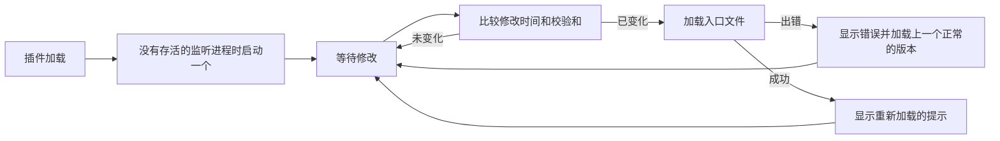

<div align="center">

# tmux-autoreload-revamped

<strong>编辑并保存 tmux 配置后，它会自动重新加载，无需按键，也无需命令。</strong>

[English](README.md) &nbsp;|&nbsp; [日本語](README.ja.md) &nbsp;|&nbsp; 简体中文 &nbsp;|&nbsp; [繁體中文（香港）](README.zh-HK.md)

[](https://github.com/tmux-revamped/tmux-autoreload-revamped/actions/workflows/tests.yml)
[](LICENSE)
[](CHANGELOG.md)

<p align="center">
  <a href="#what-it-does">功能</a> &nbsp;|&nbsp;
  <a href="#requirements">环境要求</a> &nbsp;|&nbsp;
  <a href="#installation">安装</a> &nbsp;|&nbsp;
  <a href="#usage">用法</a> &nbsp;|&nbsp;
  <a href="#configuration">配置</a> &nbsp;|&nbsp;
  <a href="#key-bindings">快捷键</a> &nbsp;|&nbsp;
  <a href="#how-it-works">工作原理</a>
</p>

</div>

**4** 种监听后端。**12** 个选项。**5** 个子命令。CI 在 **10** 种 Linux 和 macOS 工具链组合上运行测试。

---

<a id="what-it-does"></a>

## 功能

插件监听 tmux 加载的每个配置文件，以及这些文件通过 `source` 引入的每个文件。其中任何一个发生变化时，它会重新加载配置，并在状态栏显示 `tmux config reloaded (tmux.conf)`。

- 插件比较内容的校验和，因此字节没有变化的保存不会触发重新加载。
- 含有错误的修改会显示出错的文件和 tmux 的错误信息，然后重新加载该文件上一次成功加载的版本。
- 窗格处于复制模式时发生的修改会被暂缓，所以重新加载不会打断选择操作。所有窗格退出模式后的第一次检查会应用它：轮询时是下一个周期，有监听工具时是下一个文件事件。
- 每个 tmux 服务器只运行一个监听进程。再次加载插件时，存活的监听进程会被沿用，已停止的会被替换。

<a id="requirements"></a>

## 环境要求

| 工具 | 版本 | 用途 |
|:-----|:--------|:-----------|
| tmux | 3.2 或更高 | `#{config_files}`，列出已加载的配置文件 |
| bash | 3.2 或更高 | 所有脚本，包括 macOS 的 `/bin/bash` |
| `fswatch`、`inotifywait` 或 `entr` | 任意 | 可选，事件驱动的重新加载；都没有时插件改用轮询 |
| `osascript` 或 `notify-send` | 任意 | 可选，桌面通知 |

支持 macOS 和 Linux，x86_64 和 arm64。文件修改时间先用 GNU 的 `stat -c` 读取，再用 BSD 的 `stat -f`，因此在 macOS 自带工具、GNU coreutils 和 uutils coreutils 上都能运行。

<a id="installation"></a>

## 安装

### 使用 TPM

把插件加入 `~/.tmux.conf`，然后按 `prefix + I`：

```tmux
set -g @plugin 'tmux-revamped/tmux-autoreload-revamped'
```

### 手动安装

```bash
git clone https://github.com/tmux-revamped/tmux-autoreload-revamped ~/.tmux/plugins/tmux-autoreload-revamped
```

然后在 `~/.tmux.conf` 中加入这一行，并重新加载一次 tmux：

```tmux
run-shell ~/.tmux/plugins/tmux-autoreload-revamped/autoreload-revamped.tmux
```

<a id="usage"></a>

## 用法

保存 `~/.tmux.conf` 或它引入的任何文件。tmux 会在下一个文件事件时应用配置；没有安装监听工具时，在 `@autoreload_revamped_interval` 秒内应用。

[`src/autoreload.sh`](src/autoreload.sh) 中的脚本还支持子命令：

| 子命令 | 作用 |
|:-----------|:-------|
| `reload` | 立即加载入口文件 |
| `pause` | 停止响应修改 |
| `resume` | 恢复响应修改 |
| `toggle` | 在暂停和运行之间切换 |
| `status` | 输出状态、监听进程的 pid 和后端 |

```bash
~/.tmux/plugins/tmux-autoreload-revamped/src/autoreload.sh status
```

```text
autoreload-revamped: active; watcher pid 48213; backend fswatch
```

<a id="configuration"></a>

## 配置

| 选项 | 默认值 | 含义 |
|:-------|:--------|:--------|
| `@autoreload_revamped_files` | 空 | 要监听的文件，用逗号或空格分隔，支持 `~` 展开；设置后会取代 tmux 加载的文件 |
| `@autoreload_revamped_entrypoints` | 已加载的配置文件 | 每次重新加载时加载的文件 |
| `@autoreload_revamped_interval` | `2` | 轮询时两次检查之间的秒数 |
| `@autoreload_revamped_quiet` | `0` | `1` 隐藏重新加载的提示 |
| `@autoreload_revamped_discover` | `1` | 跟随 `source` 和 `source-file` 行，最多 8 层；`0` 只监听顶层文件 |
| `@autoreload_revamped_atomic` | `1` | 同时监听每个文件所在的目录，以捕获通过重命名保存的编辑器；`0` 只监听文件 |
| `@autoreload_revamped_validate` | `1` | 加载出错时，加载出错文件上一个正常的版本；`0` 不回滚 |
| `@autoreload_revamped_defer` | `1` | 有窗格处于复制模式或其他模式时等待；`0` 立即重新加载 |
| `@autoreload_revamped_selective` | `0` | `1` 只加载包含被修改文件的那些入口文件 |
| `@autoreload_revamped_backoff_max` | `30` | 连续重新加载失败后，轮询间隔的最大秒数 |
| `@autoreload_revamped_flash` | `0` | `1` 以反色再次显示重新加载的提示 |
| `@autoreload_revamped_notify` | `0` | `1` 每次重新加载时发送桌面通知 |

```tmux
set -g @autoreload_revamped_files '~/.tmux.conf ~/.config/tmux/theme.conf'
set -g @autoreload_revamped_notify '1'
```

### 内部状态

以下选项由插件自己写入，请不要设置。

| 选项 | 内容 |
|:-------|:------|
| `@autoreload_revamped_pid` | 正在运行的监听进程的 pid |
| `@autoreload_revamped_paused` | 暂停时为 `1`，否则为 `0` |
| `@autoreload_revamped_snapshot` | 每个被监听文件一行 `path mtime` |
| `@autoreload_revamped_hash` | 所有被监听文件内容的校验和 |
| `@autoreload_revamped_fail_count` | 连续失败的重新加载次数，会把轮询间隔延长到 `@autoreload_revamped_backoff_max` |

<a id="key-bindings"></a>

## 快捷键

插件不绑定任何按键。要在 tmux 中重新加载或暂停，请自行绑定子命令：

```tmux
bind R run-shell "~/.tmux/plugins/tmux-autoreload-revamped/src/autoreload.sh reload"
bind P run-shell "~/.tmux/plugins/tmux-autoreload-revamped/src/autoreload.sh toggle"
```

<a id="how-it-works"></a>

## 工作原理



监听进程按 `fswatch`、`inotifywait`、`entr` 的顺序使用第一个找到的工具，都没有时使用轮询。每次重新加载失败后，轮询的等待时间加倍，最长 `@autoreload_revamped_backoff_max` 秒。

监听进程启动时记录 tmux 服务器的 pid。该服务器退出，或套接字上换成另一个服务器响应时，监听进程就会退出。

入口文件的备份位于 `~/.tmux/autoreload-revamped/backup`。监听进程在启动时以及每次重新加载成功后写入备份。设置环境变量 `AR_CACHE_DIR` 可以更改位置。

<a id="development"></a>

## 开发

| 命令 | 运行内容 |
|:--------|:-------------|
| `make test` | [`test/`](test) 下的 bats 测试 |
| `make lint` | 对所有 shell 文件运行 shellcheck |
| `make coverage` | 在 Linux 上用 kcov 统计行覆盖率，低于 95% 时失败 |

选择监听工具、检测修改和处理路径的纯函数位于 [`src/lib/autoreload/autoreload.sh`](src/lib/autoreload/autoreload.sh)。

<a id="license"></a>

## 许可证

[MIT](LICENSE)，copyright Gustavo Franco。

<!-- family:begin -->

## tmux-revamped 插件家族

这个插件是 tmux-revamped 插件家族的一员。每个成员都带有 [`FAMILY.md`](FAMILY.md) 中相同的约定、`family/` 下相同的工具和相同的共享库，并由校验和清单保持逐字节一致。它们按一起安装来设计：任何成员都不会占用其他成员已占用的按键或 tmux 选项。

在一个成员中发现的缺陷，要在所有成员中排查之后，修复才算完成。这项义务写在约定里，而不是靠记忆，并通过 `family/bin/sweep` 来履行。

| 成员 | 功能 |
|---|---|
| [`tmux-autoreload-revamped`](https://github.com/tmux-revamped/tmux-autoreload-revamped) | **本插件**，编辑并保存 tmux 配置后自动重新加载，无需按键，也无需命令 |
| [`tmux-battery-revamped`](https://github.com/tmux-revamped/tmux-battery-revamped) | 在 tmux 状态栏显示电池状态，从不阻塞状态栏渲染 |
| [`tmux-bluetooth-revamped`](https://github.com/tmux-revamped/tmux-bluetooth-revamped) | 在 tmux 状态栏显示每个已连接的蓝牙设备及其电量，不阻塞渲染 |
| [`tmux-cpu-revamped`](https://github.com/tmux-revamped/tmux-cpu-revamped) | 在 tmux 状态栏显示 CPU 负载、温度和频率，从不阻塞渲染 |
| [`tmux-disk-revamped`](https://github.com/tmux-revamped/tmux-disk-revamped) | 在 tmux 状态栏显示磁盘用量，从不阻塞状态栏渲染 |
| [`tmux-extract-revamped`](https://github.com/tmux-revamped/tmux-extract-revamped) | 用 fzf 从屏幕上挑选 URL、路径、哈希或其他片段，并在光标处输入，纯 shell 实现 |
| [`tmux-fzf-revamped`](https://github.com/tmux-revamped/tmux-fzf-revamped) | 在弹出窗口的 fzf 选择器中切换、关闭、重命名或新建 tmux 会话、窗口和窗格 |
| [`tmux-git-revamped`](https://github.com/tmux-revamped/tmux-git-revamped) | 在 tmux 状态栏显示当前窗格的 git 分支、改动和托管平台计数，不阻塞状态栏 |
| [`tmux-gpu-revamped`](https://github.com/tmux-revamped/tmux-gpu-revamped) | 在 tmux 状态栏显示 NVIDIA、AMD、Intel 和 Apple GPU 的负载、温度、频率、功耗和显存 |
| [`tmux-kube-revamped`](https://github.com/tmux-revamped/tmux-kube-revamped) | 不借助 kubectl，从 kubeconfig 解析当前的 Kubernetes 上下文和命名空间，显示在 tmux 状态栏 |
| [`tmux-launcher-revamped`](https://github.com/tmux-revamped/tmux-launcher-revamped) | 在弹出窗口或窗口中启动任意 TUI 应用，工作目录为当前窗格的目录，按键可配置 |
| [`tmux-logging-revamped`](https://github.com/tmux-revamped/tmux-logging-revamped) | 把任意窗格保存到文件：实时记录、完整回滚历史或单次截图 |
| [`tmux-music-revamped`](https://github.com/tmux-revamped/tmux-music-revamped) | 在 tmux 状态栏显示正在播放的曲目，从不阻塞状态栏渲染 |
| [`tmux-network-revamped`](https://github.com/tmux-revamped/tmux-network-revamped) | 在 tmux 状态栏显示网络吞吐量，从不阻塞渲染 |
| [`tmux-pain-control-revamped`](https://github.com/tmux-revamped/tmux-pain-control-revamped) | tmux 的标准窗格和窗口管理快捷键，适配版本，贴合 vim 习惯，全部可配置 |
| [`tmux-persist-revamped`](https://github.com/tmux-revamped/tmux-persist-revamped) | 保存所有 tmux 会话、窗口和窗格，定时自动保存，并在重启后全部恢复 |
| [`tmux-plugin-template`](https://github.com/tmux-revamped/tmux-plugin-template) | tmux-revamped 插件的起点：共享库、bats 测试框架、CI 和家族工具 |
| [`tmux-pomodoro-revamped`](https://github.com/tmux-revamped/tmux-pomodoro-revamped) | 显示在 tmux 状态栏的番茄钟，所有状态都保存在 tmux 选项中，不使用临时文件 |
| [`tmux-ram-revamped`](https://github.com/tmux-revamped/tmux-ram-revamped) | 在 tmux 状态栏显示内存、交换空间和内存压力，在后台采样，渲染从不等待 |
| [`tmux-reorder-revamped`](https://github.com/tmux-revamped/tmux-reorder-revamped) | 用鼠标沿 tmux 状态栏拖动窗口标签，以移动该窗口 |
| [`tmux-scroll-revamped`](https://github.com/tmux-revamped/tmux-scroll-revamped) | 把鼠标滚轮交给能自行滚动的应用，其他情况下进入 tmux 复制模式 |
| [`tmux-sensible-revamped`](https://github.com/tmux-revamped/tmux-sensible-revamped) | 按 tmux 版本和终端启用的合理默认设置，不改动你自己设置的选项 |
| [`tmux-tiling-revamped`](https://github.com/tmux-revamped/tmux-tiling-revamped) | tmux 的平铺窗口管理：8 种布局，包括 BSP 的 dwindle 和 spiral，并支持撤销布局 |
| [`tmux-time-revamped`](https://github.com/tmux-revamped/tmux-time-revamped) | 在 tmux 状态栏显示本地时钟和世界时钟，按时段着色，带倒计时和夏令时提醒 |
| [`tmux-weather-revamped`](https://github.com/tmux-revamped/tmux-weather-revamped) | 在 tmux 状态栏显示来自 wttr.in 的天气，在后台获取，状态栏从不等待 |

### 检查安装

所有成员都在磁盘上时，一条命令即可报告它们之间的冲突：

```sh
family/bin/doctor --live
```

它读取每个成员和正在运行的 tmux 服务器，报告重复的按键、重复的状态栏占位符、不符合命名规则的选项，以及约定版本落后的成员。

<!-- family:end -->
