<div align="center">

# tmux-autoreload-revamped

<strong>编辑并保存 tmux 配置后，它会自动重新加载，无需按键，也无需命令。</strong>

[English](README.md) &nbsp;|&nbsp; [日本語](README.ja.md) &nbsp;|&nbsp; 简体中文 &nbsp;|&nbsp; [繁體中文（香港）](README.zh-HK.md)

[](https://github.com/tmux-revamped/tmux-autoreload-revamped/actions/workflows/ci.yml)
[](https://github.com/tmux-revamped/tmux-autoreload-revamped/releases/latest)
[](https://scorecard.dev/viewer/?uri=github.com/tmux-revamped/tmux-autoreload-revamped)
[](LICENSE)

<p align="center">
  <a href="#快速开始"><strong>快速开始</strong></a> &nbsp;|&nbsp;
  <a href="#用法">用法</a> &nbsp;|&nbsp;
  <a href="#工作原理">工作原理</a> &nbsp;|&nbsp;
  <a href="#界面">界面</a>
</p>

</div>

<p align="center">
  
</p>

```console
$ echo 'set -g status-style bg=blue' >> ~/.tmux.conf
$ autoreload-revamped status
autoreload-revamped: active; watcher pid 48213; backend fswatch
```

插件监视 tmux 加载的每个配置文件，以及这些文件 `source` 的每个文件。其中一个文件保存后内容有变化时，它会重新加载配置，并在状态栏显示 `tmux config reloaded (tmux.conf)`。字节没有变化的保存不会重新加载；出错的保存只显示一次 tmux 的错误，并重新加载上一份正常的副本；窗格处于复制模式时的修改会等到窗格离开该模式。

---

## 快速开始

### 前提条件

| 工具 | 版本 | 用途 |
|:-----|:--------|:---------|
| tmux | 3.2 或更高 | 家族的最低版本；列出已加载配置文件的 `#{config_files}` 也需要它 |
| `fswatch`、`inotifywait` 或 `entr` | 可选 | 保存的同时重新加载；没有时插件每 `@autoreload_revamped_interval` 秒检查一次 |
| `osascript` 或 `notify-send` | 可选 | 用于 `@autoreload_revamped_notify` |
| gum | 可选 | `autoreload-revamped` 的菜单、表格和颜色；没有它，所有命令都输出纯文本 |

### 安装

```tmux
set -g @plugin 'tmux-revamped/tmux-autoreload-revamped'
```

然后按 `prefix + I`。不用 TPM 时，克隆仓库，并在 `~/.tmux.conf` 中运行它的入口文件：

```bash
git clone https://github.com/tmux-revamped/tmux-autoreload-revamped ~/.tmux/plugins/tmux-autoreload-revamped
```

```tmux
run-shell ~/.tmux/plugins/tmux-autoreload-revamped/autoreload-revamped.tmux
```

在克隆的目录中运行 `make install`，还会把 `autoreload-revamped` 放进 `~/.local/bin`，把它的 man 手册和补全放在 `~/.local/share` 下。

### 验证

```bash
~/.tmux/plugins/tmux-autoreload-revamped/bin/autoreload-revamped doctor
```

## 用法

保存 `~/.tmux.conf` 或它 source 的任何文件即可。插件不绑定任何按键；需要按键时，自己绑定命令：

```tmux
bind-key <key> run-shell "~/.tmux/plugins/tmux-autoreload-revamped/bin/autoreload-revamped toggle"
```

| 命令 | 作用 |
|:--------|:-------------|
| `autoreload-revamped apply` | 没有存活的监视进程时启动一个；插件加载时入口点会运行它 |
| `autoreload-revamped watch` | 监视配置文件，直到 tmux 服务器结束；这就是 `apply` 留下的进程 |
| `autoreload-revamped reload` | 立即加载入口文件 |
| `autoreload-revamped pause` | 停止响应修改 |
| `autoreload-revamped resume` | 恢复响应修改；暂停期间的保存会在一个间隔内加载 |
| `autoreload-revamped toggle` | 在暂停和恢复之间切换 |
| `autoreload-revamped status` | 打印状态、监视进程的 pid 和后端；`--json` 输出一个对象 |
| `autoreload-revamped doctor` | 每个依赖一行，包括监视工具 |
| `autoreload-revamped version` | 版本，然后是 tmux 版本 |
| `autoreload-revamped help` | 帮助页；`man autoreload-revamped` 记录相同的命令和设置 |
| `autoreload-revamped` | 在终端上显示菜单 |

| tmux 选项 | 默认值 | 含义 |
|:------------|:--------|:--------|
| `@autoreload_revamped_files` | 无 | 要监视的文件，用逗号或空格分隔，并展开 `~`；设置后取代 tmux 加载的文件 |
| `@autoreload_revamped_entrypoints` | 已加载的配置文件 | 重新加载时 source 的文件 |
| `@autoreload_revamped_interval` | `2` | 没有监视工具时两次检查之间的秒数，也是重试被推迟或暂停的重新加载的间隔 |
| `@autoreload_revamped_quiet` | `0` | `1` 隐藏重新加载的消息 |
| `@autoreload_revamped_discover` | `1` | 跟随 `source` 和 `source-file` 行，最多 8 层；`0` 只监视顶层文件 |
| `@autoreload_revamped_atomic` | `1` | 同时监视每个文件所在的文件夹，这样能捕捉到用重命名方式保存的编辑器；`0` 只监视文件 |
| `@autoreload_revamped_validate` | `1` | 加载出错时，加载出错文件上一份正常的副本；`0` 跳过这一步 |
| `@autoreload_revamped_defer` | `1` | 任何窗格处于复制模式或其他模式时等待；`0` 立即重新加载 |
| `@autoreload_revamped_selective` | `0` | `1` 只加载包含被修改文件的入口文件 |
| `@autoreload_revamped_flash` | `0` | `1` 用反色再显示一次重新加载的消息 |
| `@autoreload_revamped_notify` | `0` | `1` 每次重新加载都发送桌面通知 |
| `@autoreload_revamped_backup_dir` | `~/.tmux/autoreload-revamped/backup` | 存放每个入口文件上一份正常副本的文件夹 |

每个选项也可以用带连字符的命令选项（例如 `--interval 5`）和环境变量（例如 `AUTORELOAD_REVAMPED_INTERVAL`）设置；命令行优先于环境变量，环境变量优先于 tmux 选项。空的 tmux 选项表示默认值。`doctor` 会指出值无法识别的设置。`@autoreload_revamped_pid` 和 `@autoreload_revamped_paused` 由插件自己写入。

<a id="工作原理"></a>

## 工作原理

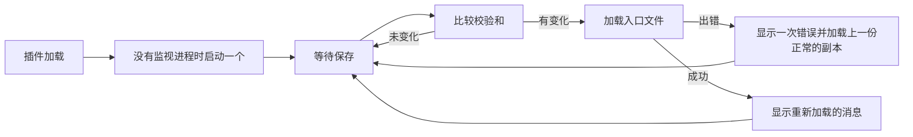

监视进程使用它找到的第一个工具，顺序是 `fswatch`、`inotifywait`、`entr`；都没有时每 `@autoreload_revamped_interval` 秒检查一次。校验和是对所有被监视文件运行一次 `cksum` 的结果。

监视进程启动时记录 tmux 服务器的 pid，该服务器结束，或者另一个服务器在套接字上应答时，它就退出。每个 tmux 服务器只运行一个监视进程：再次加载插件时，存活的监视进程继续使用，已经停止的会被重新启动。

每个入口文件上一份正常的副本存放在 `~/.tmux/autoreload-revamped/backup`，在监视进程启动时和每次重新加载成功后写入。用 `@autoreload_revamped_backup_dir` 可以换一个位置。

<a id="界面"></a>

## 界面

<details>
<summary>所有界面，在真实的 tmux 中用 <code>make screens</code> 录制，每个按键显示在状态栏上</summary>
<br>

<table>
<tr>
<td width="50%" valign="top">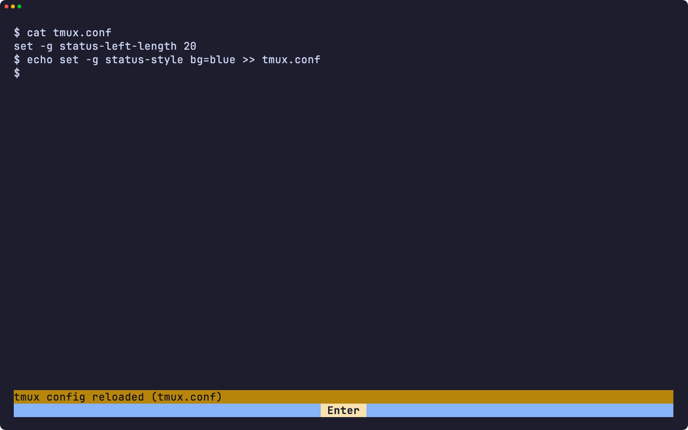<br><sub>保存后重新加载配置，并在状态栏提示，来自 <code>hero.tape</code></sub></td>
<td width="50%" valign="top">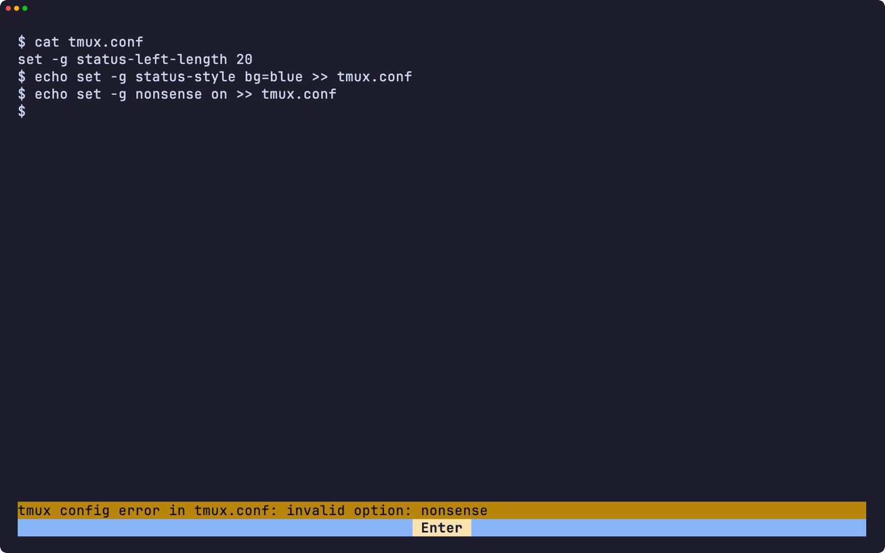<br><sub>出错的保存显示 tmux 的错误，并保留上一份正常的副本，来自 <code>hero.tape</code></sub></td>
</tr>
<tr>
<td width="50%" valign="top">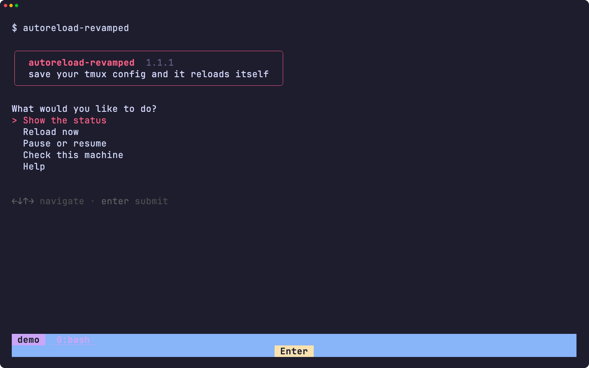<br><sub>菜单，来自 <code>hero.tape</code></sub></td>
<td width="50%" valign="top">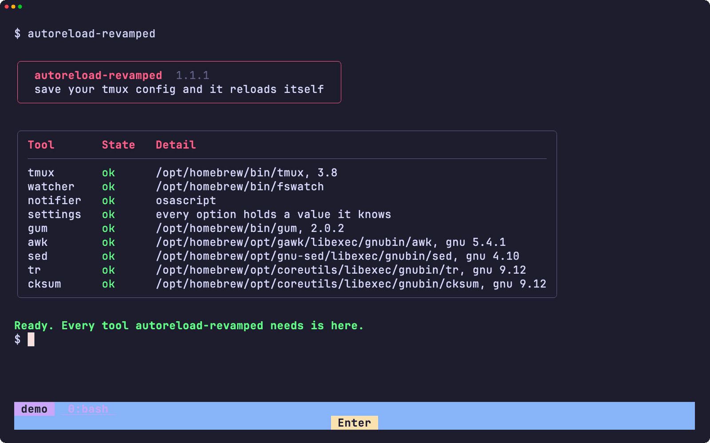<br><sub><code>doctor</code>，来自 <code>hero.tape</code></sub></td>
</tr>
<tr>
<td width="50%" valign="top">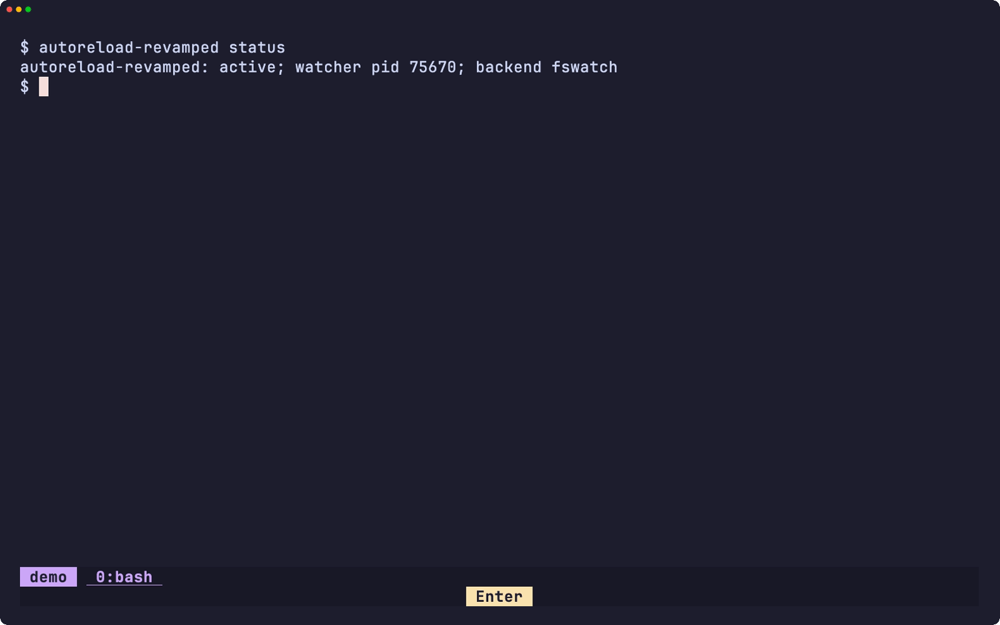<br><sub><code>status</code>，来自 <code>stills.tape</code></sub></td>
<td width="50%" valign="top">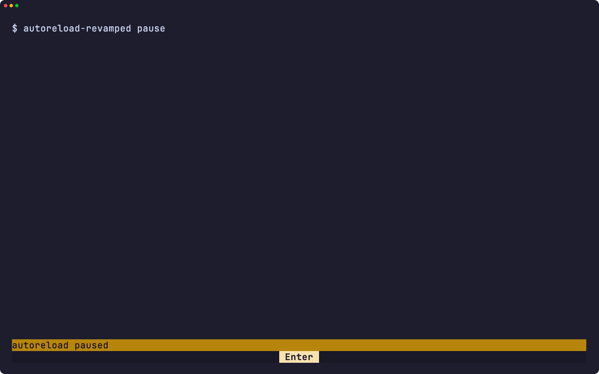<br><sub><code>pause</code> 停止响应修改，来自 <code>stills.tape</code></sub></td>
</tr>
<tr>
<td width="50%" valign="top">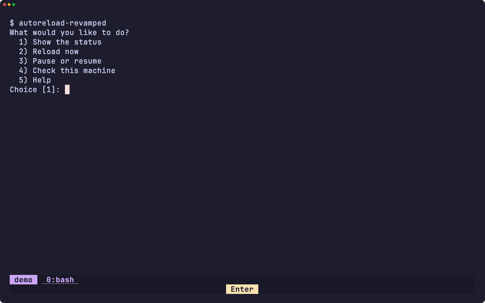<br><sub>没有 gum 的菜单，来自 <code>stills.tape</code></sub></td>
<td width="50%" valign="top">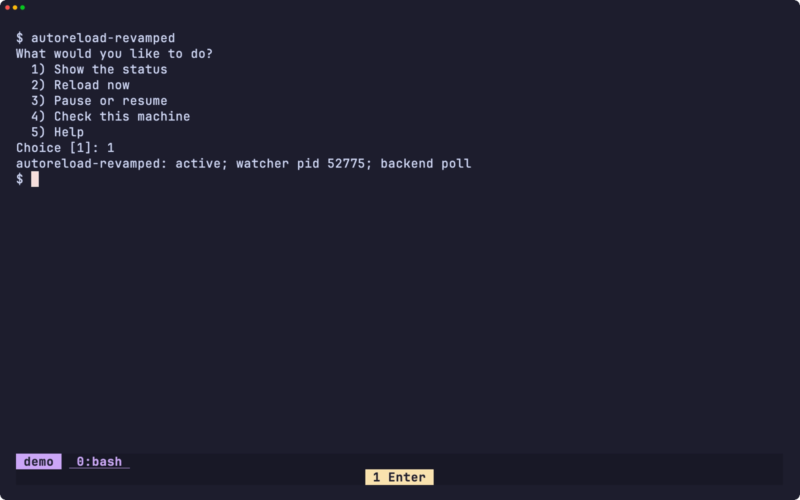<br><sub>从菜单运行 <code>status</code>，来自 <code>stills.tape</code></sub></td>
</tr>
<tr>
<td width="50%" valign="top">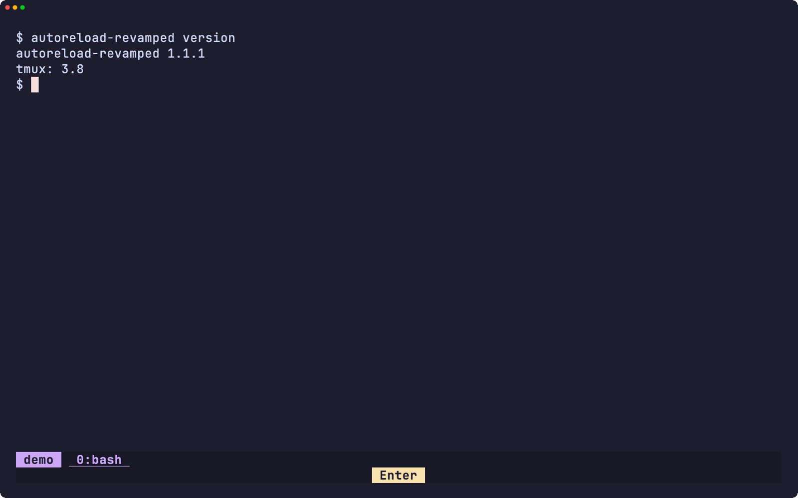<br><sub>版本，来自 <code>stills.tape</code></sub></td>
<td width="50%" valign="top">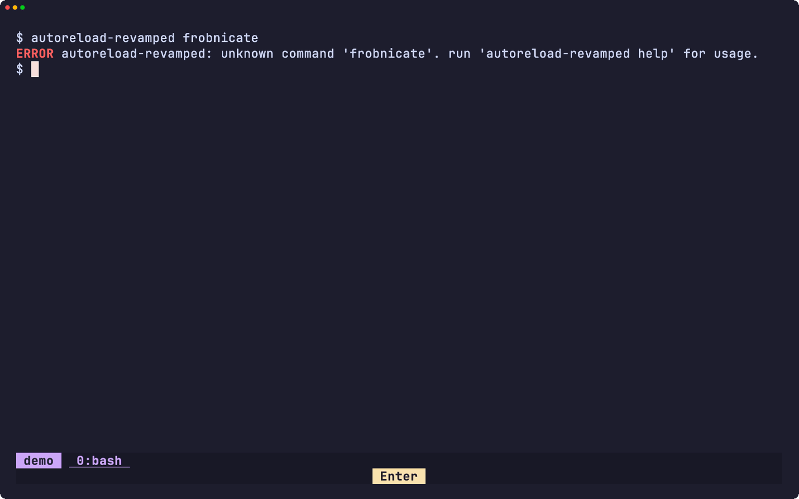<br><sub>未知命令，来自 <code>stills.tape</code></sub></td>
</tr>
<tr>
<td width="50%" valign="top">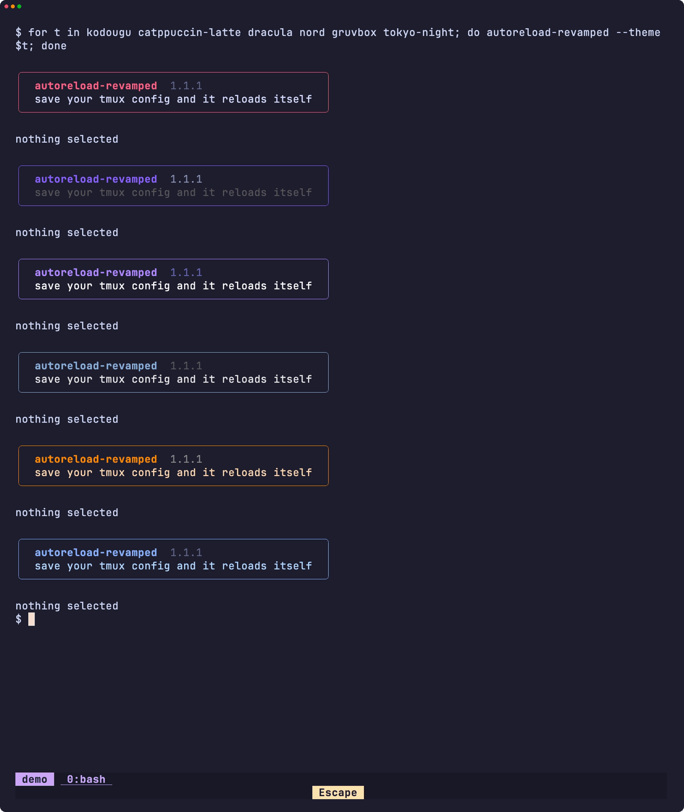<br><sub>六种主题下的标题，来自 <code>themes.tape</code></sub></td>
<td width="50%" valign="top">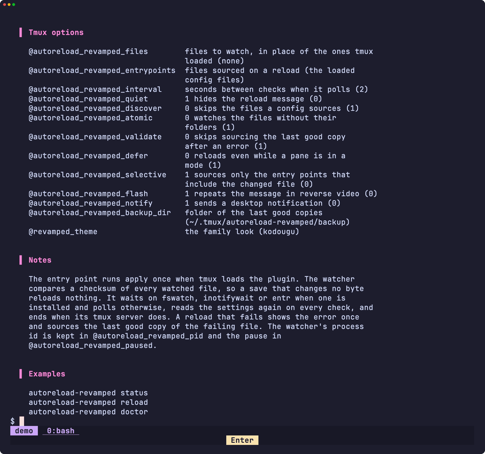<br><sub>帮助页，来自 <code>help.tape</code></sub></td>
</tr>
<tr>
<td width="50%" valign="top">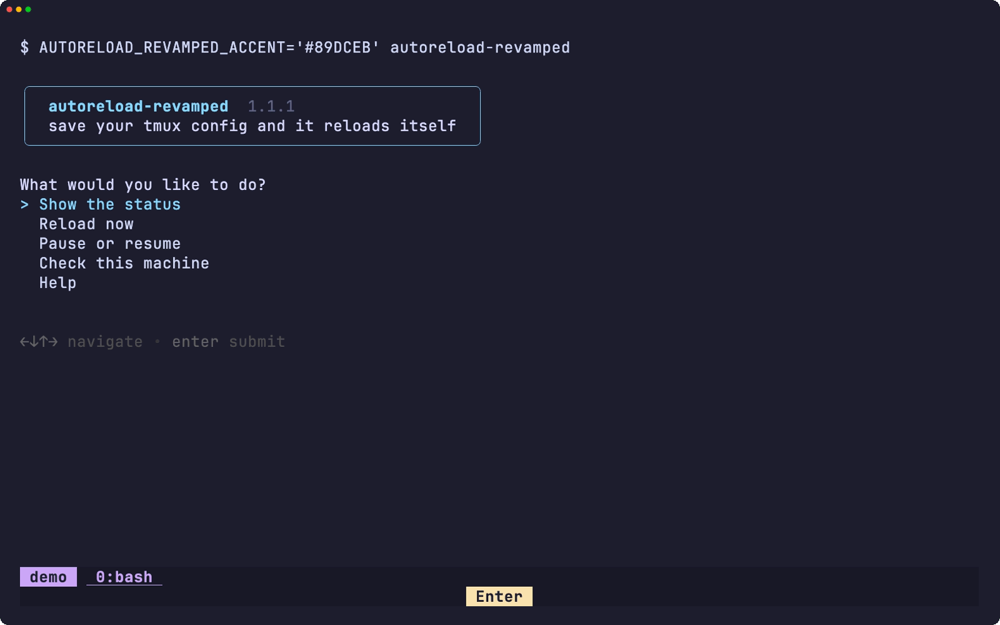<br><sub>来自 <code>AUTORELOAD_REVAMPED_ACCENT</code> 的强调色，来自 <code>stills.tape</code></sub></td>
<td width="50%" valign="top"></td>
</tr>
</table>

</details>

## 可移植性

插件是 POSIX `sh`。CI 在下面每一行上运行全部测试。

| Shell | 状态 |
|:------|:-------|
| `dash`、macOS 上的 `/bin/sh` | 支持 |
| `bash` 3.2 和 5.x、系统自带的 `zsh` 和 Homebrew 的 `zsh` | 支持 |

| 系统 | 状态 |
|:-------|:-------|
| macOS | Apple Silicon 和 Intel 上的 Tahoe，使用系统自带的工具、Homebrew 的 GNU 工具和 Homebrew 的 uutils |
| Linux | x86_64 和 arm64 上的 Ubuntu 26.04，使用 GNU coreutils、uutils 和 BusyBox |

## 开发

| 命令 | 运行内容 |
|:--------|:-------------|
| `make fmt` | 对每个脚本运行 shfmt `-i 2` |
| `make lint` | shfmt、ShellCheck、mandoc、yamllint 和 actionlint，零告警 |
| `make test` | 在系统 `sh` 下运行 bats 测试 |
| `make test-all` | 在每个已安装的 shell 下运行测试，macOS 上包括 bash 和 zsh 的两种构建 |
| `make test-linux` | 在 Ubuntu 容器中运行测试 |
| `make coverage` | 在这台 Mac 和 Ubuntu 容器中运行 bashcov，合并后以 100% 为门槛 |
| `make screens` | 用 VHS 在 tmux 中从真实插件录制上面的界面，在 macOS 上运行 |
| `make install` | 把命令、man 手册和补全安装到 `PREFIX` 下 |

在 macOS 上，运行 `brew bundle` 会根据 [`Brewfile`](Brewfile) 安装这些目标用到的所有工具。

提交遵循 Conventional Commits 格式，直接进入 `main`。`main` 上的 `ci` 通过后，`release.yml` 运行 semantic-release：自上一个标签以来的每个 `feat` 或 `fix` 都会发布新版本，更新版本常量，并把说明写进 [`CHANGELOG.md`](CHANGELOG.md)。

## 许可证

[MIT](LICENSE)，copyright Gustavo Franco。

<!-- family:begin -->

## tmux-revamped 插件家族

这个插件是 tmux-revamped 插件家族的一员。每个成员都带有 [`FAMILY.md`](FAMILY.md) 中相同的约定和相同的共享库，并且设计为一起安装：没有成员占用另一个成员占用的按键或 tmux 选项。

在一个成员中发现的缺陷，要在全部成员中排查之后才算修复完成。

| 成员 | 功能 |
|---|---|
| [`tmux-autoreload-revamped`](https://github.com/tmux-revamped/tmux-autoreload-revamped) | **本插件**，编辑并保存 tmux 配置后，它会自动重新加载，无需按键，也无需命令 |
| [`tmux-battery-revamped`](https://github.com/tmux-revamped/tmux-battery-revamped) | 在 tmux 状态栏显示电池状态，从不阻塞状态栏渲染 |
| [`tmux-bluetooth-revamped`](https://github.com/tmux-revamped/tmux-bluetooth-revamped) | 在 tmux 状态栏显示每个已连接的蓝牙设备及其电量，不阻塞渲染 |
| [`tmux-cpu-revamped`](https://github.com/tmux-revamped/tmux-cpu-revamped) | 在 tmux 状态栏显示 CPU 负载、温度和频率，从不阻塞渲染 |
| [`tmux-disk-revamped`](https://github.com/tmux-revamped/tmux-disk-revamped) | 在 tmux 状态栏显示磁盘用量，从不阻塞状态栏渲染 |
| [`tmux-extract-revamped`](https://github.com/tmux-revamped/tmux-extract-revamped) | 用 fzf 从屏幕上挑选 URL、路径、哈希或任意其他词元，并输入到光标处，全部用纯 shell 实现 |
| [`tmux-fzf-revamped`](https://github.com/tmux-revamped/tmux-fzf-revamped) | 在弹出窗口中的 fzf 选择器里切换、关闭、重命名或创建 tmux 会话、窗口和窗格 |
| [`tmux-git-revamped`](https://github.com/tmux-revamped/tmux-git-revamped) | 在 tmux 状态栏中显示活动窗格的 git 分支、改动和托管平台计数，且不阻塞渲染 |
| [`tmux-gpu-revamped`](https://github.com/tmux-revamped/tmux-gpu-revamped) | 在 tmux 状态栏中显示 NVIDIA、AMD、Intel 和 Apple GPU 的负载、温度、频率、功耗和显存 |
| [`tmux-kube-revamped`](https://github.com/tmux-revamped/tmux-kube-revamped) | 在 tmux 状态栏中显示当前的 Kubernetes 上下文和命名空间，不依赖 kubectl，直接解析 kubeconfig |
| [`tmux-launcher-revamped`](https://github.com/tmux-revamped/tmux-launcher-revamped) | 在弹出窗口或新窗口中启动任意 TUI 应用，从当前窗格的目录开始，每个应用可配置一个按键 |
| [`tmux-logging-revamped`](https://github.com/tmux-revamped/tmux-logging-revamped) | 将任意窗格保存到文件：实时日志、完整回滚缓冲区或一次性截图 |
| [`tmux-music-revamped`](https://github.com/tmux-revamped/tmux-music-revamped) | 在 tmux 状态栏显示正在播放的曲目，从不阻塞状态栏渲染 |
| [`tmux-network-revamped`](https://github.com/tmux-revamped/tmux-network-revamped) | 在 tmux 状态栏显示网络吞吐量，从不阻塞渲染 |
| [`tmux-pain-control-revamped`](https://github.com/tmux-revamped/tmux-pain-control-revamped) | tmux 的窗格和窗口管理按键，适配 tmux 版本，兼容 vim，每个 prefix 按键都可禁用 |
| [`tmux-persist-revamped`](https://github.com/tmux-revamped/tmux-persist-revamped) | 保存 tmux 的所有会话、窗口和窗格，按定时器自动保存，并在重启后全部恢复 |
| [`tmux-plugin-template`](https://github.com/tmux-revamped/tmux-plugin-template) | tmux-revamped 插件的起点：共享库、bats 测试框架和 CI |
| [`tmux-pomodoro-revamped`](https://github.com/tmux-revamped/tmux-pomodoro-revamped) | tmux 状态栏中的番茄钟计时器，所有状态都保存在 tmux 选项中，不使用临时文件 |
| [`tmux-ram-revamped`](https://github.com/tmux-revamped/tmux-ram-revamped) | 在 tmux 状态栏显示内存、交换空间和内存压力，在后台采样，渲染从不等待 |
| [`tmux-reorder-revamped`](https://github.com/tmux-revamped/tmux-reorder-revamped) | 用鼠标在 tmux 状态栏上拖动窗口标签来移动该窗口 |
| [`tmux-scroll-revamped`](https://github.com/tmux-revamped/tmux-scroll-revamped) | 将鼠标滚轮交给能自行滚动的应用，其他情况下进入 tmux 复制模式 |
| [`tmux-sensible-revamped`](https://github.com/tmux-revamped/tmux-sensible-revamped) | 按 tmux 版本和终端区分的合理默认设置，不改动你自己设置的选项 |
| [`tmux-tiling-revamped`](https://github.com/tmux-revamped/tmux-tiling-revamped) | tmux 的平铺窗口管理：八种布局，包括 BSP dwindle 和 spiral，并支持撤销布局 |
| [`tmux-time-revamped`](https://github.com/tmux-revamped/tmux-time-revamped) | 状态栏中的本地时钟和世界时钟，按一天中的时段着色，并提供倒计时和夏令时提醒 |
| [`tmux-weather-revamped`](https://github.com/tmux-revamped/tmux-weather-revamped) | 在后台从 wttr.in 获取天气并显示在状态栏，状态栏无需等待 |

<!-- family:end -->
